# خلاصه نتایج

- **صحت‌سنجی عددی (مرحله ۱):** حل حجم محدود کروی با حجم واقعی پوسته‌ها و مساحت واقعی وجوه، با حل تحلیلی سری تطبیق دارد؛ مرتبه همگرایی مکانی 2.00 و مرتبه زمانی 1.00 (اویلر پسرو) و 2.00 (کرانک–نیکلسون با شروع راناخر) اندازه‌گیری شد. موازنه جرم میان «داروی باقی‌مانده» و «انتگرال مستقل شار خروجی» تا دقت ماشین (حداکثر اختلاف $1.4\times10^{-14}$) برقرار است، غلظت در همه گام‌ها مثبت ماند و کسر رهایش در همه گام‌ها صعودی بود.
- **داده (مرحله ۲):** در فایل اکسل ممیزی‌شده هیچ منحنی کامل زمان–رهایش وجود نداشت. بنابراین دیتاست انگلیسی با منشأ هر نقطه از PDFهای پیوست ساخته شد: ۱۵ نقطه چاپ‌شده (مورفین)، ۳۶ نقطه استخراج‌شده از عملگرهای برداری PDF (دیکلوفناک) و بقیه با رقومی‌سازی کالیبره‌شده روی علامت‌های محور. در همه موارد که متن مقاله عدد صریح داشت، رقومی‌سازی با آن عدد تا حدود ±0.15 واحد هم‌خوانی داشت.
- **مدل نفوذ ثابت:** برای دیکلوفناک (GM1–GM3) و ایکاریین (GM-1، GM-2) در کل بازه ۲۱ تا ۳۰ روزه با RMSE حدود 1.3 تا 3.0 درصد و خطای پیش‌بینی زمان‌های کنارگذاشته‌شده 0.6 تا 4.7 درصد کافی است. برای کتوپروفن با اتصال عرضی کم (MS/K-2 و MS/K-3)، bFGF (هر دو فرمولاسیون)، و ونکومایسین درون کیسه دیالیز، فیک ثابت به‌طور سیستماتیک خطا دارد. برای جنتامایسین (Chang 2023)، فیک فقط تا روز ۱۶ پاسخگوست و رهایش ثانویه پس از آن را بازتولید نمی‌کند.
- **Abbasi و همکاران (2008):** متن کامل مقاله در پیوست‌ها نبود و از این محیط نیز در دسترس قرار نگرفت. بنابراین تعریف $C_w$، واحدها و فرض‌های رابطه را **نمی‌توان از متن اصلی تأیید کرد**. مقادیر $D$ و $\beta$ فقط با برچسب «نقل از اکسل» آمده‌اند و این رابطه به مقاله عبدخدایی نسبت داده نشده است.
- **آمادگی داده:** در هیچ‌یک از هشت کیس، $C_w$ یا داده لازم برای محاسبه آن (جرم آب بر حجم خیس) وجود ندارد. تنها کیسی که تورم و رهایش هر دو برای همان فرمولاسیون و در همان محیط اندازه‌گیری شده‌اند Kodra 2026 است. در آن کیس هم تورم فقط به‌صورت جرمی (SD%) گزارش شده، حجم یا شعاع در طول زمان اندازه‌گیری نشده، جرم شبکه ثابت نمی‌ماند و اولین نقطه تورم (۱ ساعت) بعد از بخش بزرگی از رهایش است. نتیجه: مدل شعاع ثابت حفظ می‌شود و مدل مرز متحرک با این داده‌ها قابل پشتیبانی نیست.
- **مقایسه مدل‌ها:** مدل وابسته به آب‌گیری فقط به‌عنوان «مدل نامزد» و با شاخص جرمی تورم (نه $C_w$) روی Kodra آزموده شد. در MS/K-1، پارامتر $\beta$ در برازش کامل به صفر رسید و پیش‌بینی آزمون بدتر شد. در MS/K-2 و MS/K-3، بهبود برازش کاملاً به شکل فرضی آب‌گیری بین ۰ تا ۱ ساعت بستگی داشت که اندازه‌گیری نشده است. مطالعه شناسایی‌پذیری با داده مصنوعی نشان داد منحنی رهایش به‌تنهایی $\beta$ را تعیین نمی‌کند. بنابراین **بهبود برازش هیچ شاهدی برای مکانیسم تورم فراهم نمی‌کند**.
- **ورود به مرحله تخریب:** برای Kodra (داده DR% همان فرمولاسیون‌ها موجود است) و Chang 2.5dM-G (رهایش ثانویه پس از روز ۱۶)، ورود به مرحله تخریب به‌عنوان مدل نامزد توجیه دارد. شرط آن، کالیبراسیون پارامترهای تخریب با داده تخریب مستقل و آزمون روی همان تقسیم زمانی است. برای دیکلوفناک و ایکاریین، شواهدی از نیاز به تخریب در بازه اندازه‌گیری دیده نمی‌شود.

> نگاشت با طرح تخته‌سفید جلسه: منحنی «فیک $D$ ثابت» با دیکلوفناک و ایکاریین منطبق است. منحنی «۱» (افزایش دیرهنگام) با Chang 2.5dM-G و جهش MS/K-2 هم‌خوان است. منحنی «۲» (تخت‌شدن زیر ۱۰۰٪) با ونکومایسین (66 تا 78 درصد) و مورفین (حدود 59 درصد) هم‌خوان است. ناحیه دایره‌شده ابتدایی (burst) فقط در ونکومایسین با مدل پشتیبانی آماری گرفت و همان‌جا هم با نقاط ساعت‌های اول تناقض دارد (بخش ۳-۴).

# ۱. صحت‌سنجی عددی

## ۱-۱. مسئله و فرض‌ها

فرض‌ها عبارت‌اند از: کره متقارن، غلظت اولیه یکنواخت، نفوذ همسانگرد، شرط sink کامل، و نبود تورم، تخریب، اتصال دارو و مقاومت انتقال جرم خارجی. در این مرحله هیچ داده مقاله‌ای برازش نشده است.

$$\frac{\partial C}{\partial t}=\frac{D}{r^{2}}\frac{\partial}{\partial r}\left(r^{2}\frac{\partial C}{\partial r}\right),\qquad C(r,0)=C_0,\quad \left.\frac{\partial C}{\partial r}\right|_{r=0}=0,\quad C(R,t)=0\ (t>0)$$

با متغیرهای بی‌بعد $x=r/R$، $\tau=Dt/R^{2}$ و $c=C/C_0$:

$$\frac{\partial c}{\partial \tau}=\frac{1}{x^{2}}\frac{\partial}{\partial x}\left(x^{2}\frac{\partial c}{\partial x}\right),\qquad F(\tau)=1-3\int_{0}^{1}c(x,\tau)\,x^{2}\,dx$$

حل تحلیلی کسر رهایش (Crank, 1975):

$$F(\tau)=1-\frac{6}{\pi^{2}}\sum_{n=1}^{\infty}\frac{\exp\left(-n^{2}\pi^{2}\tau\right)}{n^{2}}$$

## ۱-۲. کنترل همگرایی سری

تعداد جملات برای هر $\tau$ جداگانه انتخاب شد، طوری که کران بالای دقیق باقیمانده سری از $10^{-13}$ کمتر باشد:

$$\frac{6}{\pi^{2}}\sum_{n>N}\frac{e^{-n^{2}\pi^{2}\tau}}{n^{2}}\le\frac{6}{\pi^{2}}\,\frac{e^{-(N+1)^{2}\pi^{2}\tau}}{(N+1)^{2}\left[1-e^{-2(N+1)\pi^{2}\tau}\right]}$$

برای $\tau=10^{-6}$ به 1373 جمله و برای $\tau\ge 0.1$ به کمتر از 5 جمله نیاز است. برای کنترل مستقل، فرم زمان‌کوتاه (روش تصاویر) هم محاسبه شد:

$$F(\tau)=6\sqrt{\tau}\left[\frac{1}{\sqrt{\pi}}+2\sum_{n=1}^{\infty}\operatorname{ierfc}\left(\frac{n}{\sqrt{\tau}}\right)\right]-3\tau$$

حداکثر اختلاف دو فرم برای $\tau\le0.05$ برابر $9.7\times10^{-14}$ است.

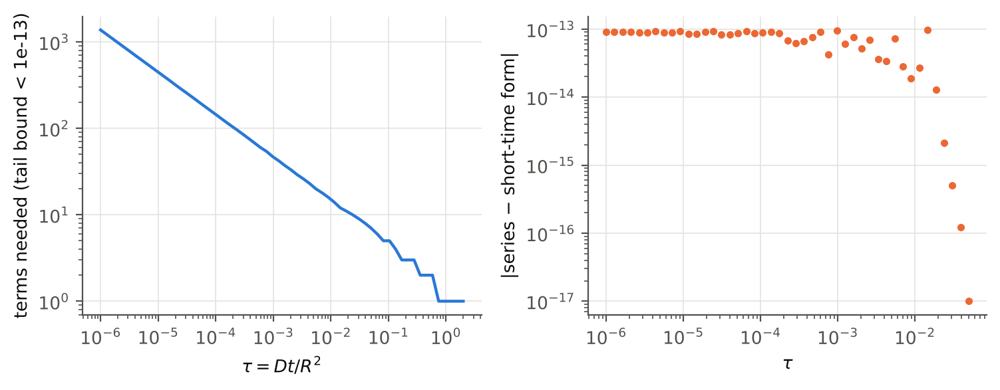

**شکل ۱-۱.** محور افقی در هر دو پانل زمان بی‌بعد $\tau=Dt/R^2$ با مقیاس لگاریتمی است. محور عمودی پانل چپ تعداد جملات لازم برای رسیدن کران باقیمانده به $10^{-13}$ و محور عمودی پانل راست اختلاف مطلق فرم سری با فرم زمان‌کوتاه است. خط آبی تعداد جملات و نقاط نارنجی اختلاف دو فرم را نشان می‌دهند. پارامتری برازش نشده است. نتیجه: در زمان‌های کوتاه، که در داده‌های رهایش اهمیت دارند، سری با چند جمله معدود همگرا نمی‌شود. کنترل کران باقیمانده یا استفاده از فرم زمان‌کوتاه ضروری است و ارزیاب نهایی هر دو را به کار می‌برد.

## ۱-۳. گسسته‌سازی حجم محدود کروی

دامنه $0\le x\le1$ به $N$ سلول با وجوه $x_{i\pm1/2}$ تقسیم شد. برای هر سلول، حجم واقعی پوسته و برای هر وجه، مساحت واقعی کره به کار رفت (هر دو به ازای $4\pi$):

$$V_i=\frac{x_{i+1/2}^{3}-x_{i-1/2}^{3}}{3},\qquad A_{i+1/2}=x_{i+1/2}^{2},\qquad V_i\frac{dc_i}{d\tau}=A_{i+1/2}\frac{c_{i+1}-c_i}{\Delta x_{i+1/2}}-A_{i-1/2}\frac{c_i-c_{i-1}}{\Delta x_{i-1/2}}$$

در مرکز، $A_{1/2}=0$ است و شار به‌طور صریح صفر قرار داده شد. روی سطح، شرط sink با $c=0$ در فاصله نیم‌سلول اعمال شد. گام زمانی با روش θ انجام شد (اویلر پسرو یا کرانک–نیکلسون). برای جلوگیری از نوسان ناشی از ناپیوستگی شرط اولیه و مرزی، چهار نیم‌گام اولیه با اویلر پسرو برداشته شد (شروع راناخر).

کسر رهایش به دو روش مستقل محاسبه شد: یکی از داروی باقی‌مانده، $F_{inv}=1-\sum V_ic_i/\sum V_ic_i(0)$، و دیگری از انتگرال زمانی شار خروجی سطح با همان وزن‌دهی θ:

$$F_{flux}(\tau)=\frac{1}{M_0}\int_0^{\tau}A_s\frac{c_N}{1-x_N}\,d\tau'$$

## ۱-۴. نتایج صحت‌سنجی

| کمیت کنترلی | مقدار |
|---|---|
| حداکثر خطای $F$ برای N=100، $\Delta\tau=10^{-5}$ (کل زمان / $\tau\ge0.01$) | $6.1\times10^{-4}$ / $1.5\times10^{-4}$ |
| حداکثر خطای $F$ برای N=200 (کل زمان / $\tau\ge0.01$) | $1.5\times10^{-4}$ / $3.7\times10^{-5}$ |
| مرتبه همگرایی مکانی (خطای $F$، N از 10 تا 320) | 2.22، 2.04، 2.01، 2.00، 2.00 |
| مرتبه همگرایی مکانی (نرم L2 وزنی پروفایل در $\tau=0.05$) | 2.01، 2.00، 2.00، 2.00، 2.00 |
| مرتبه زمانی اویلر پسرو / کرانک–نیکلسون (N=200، مرجع روی همان مش) | 1.00 / 2.00 |
| حداکثر $|F_{inv}-F_{flux}|$ | $1.4\times10^{-14}$ |
| کمینه غلظت در همه گام‌ها (همه اجراهای اصلی) | $2.6\times10^{-7}>0$ |
| کمینه افزایش رهایش در هر گام | $1.0\times10^{-8}>0$ (صعودی) |
| $\tau$ لازم برای رهایش 10، 50 و 90 درصد | 0.00092، 0.0305، 0.183 |

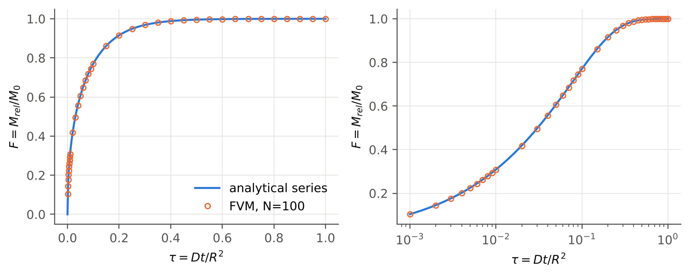

**شکل ۱-۲.** محور افقی $\tau$ است (پانل چپ خطی، پانل راست لگاریتمی) و محور عمودی کسر رهایش $F=M_{rel}/M_0$. خط آبی حل تحلیلی سری و دایره‌های توخالی نارنجی حل FVM با N=100 هستند. پارامتری برازش نشده است. نتیجه: دو حل در کل بازه، از جمله در زمان‌های کوتاه، در محدوده دقت رسم بر هم منطبق‌اند.

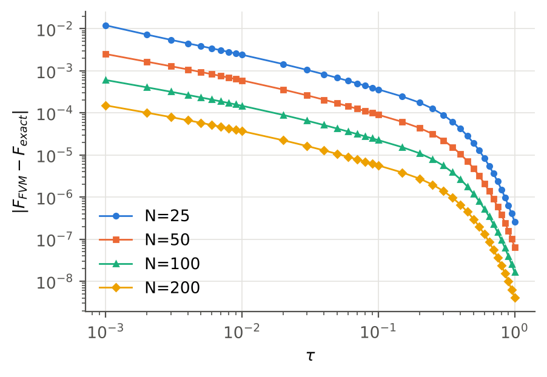

**شکل ۱-۳.** محور افقی $\tau$ (لگاریتمی) و محور عمودی $|F_{FVM}-F_{exact}|$ (لگاریتمی) است. هر رنگ و نشانه یک مش است (N=25، 50، 100، 200). نتیجه: بیشترین خطا در زمان‌های بسیار کوتاه رخ می‌دهد، جایی که لایه مرزی غلظت از یک سلول باریک‌تر است. با دو برابر کردن N، خطا حدود چهار برابر کم می‌شود.

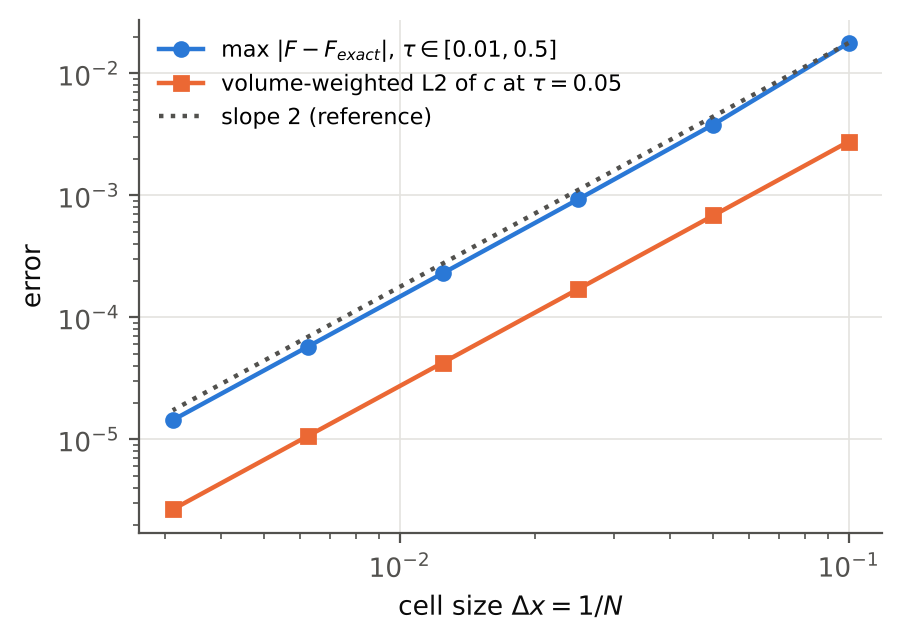

**شکل ۱-۴.** محور افقی اندازه سلول $\Delta x=1/N$ و محور عمودی خطا است (هر دو لگاریتمی). دایره آبی بیشینه خطای $F$ در بازه $0.01\le\tau\le0.5$، مربع نارنجی نرم L2 حجمی خطای پروفایل در $\tau=0.05$ و خط‌چین خاکستری شیب مرجع 2 است. گام زمانی بسیار کوچک ($2\times10^{-6}$) انتخاب شد تا خطای زمانی در این آزمون ناچیز باشد. نتیجه: مرتبه دوم مکانی تأیید می‌شود.

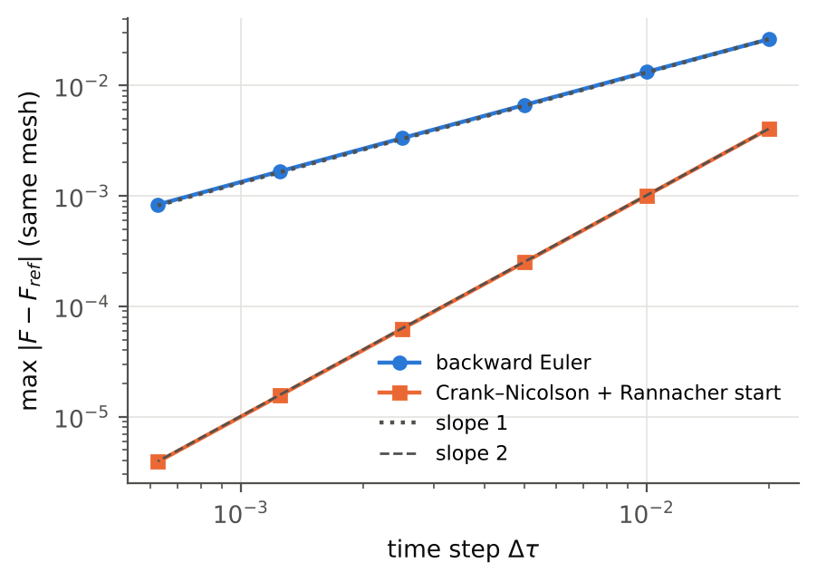

**شکل ۱-۵.** محور افقی گام زمانی $\Delta\tau$ و محور عمودی بیشینه اختلاف با حل مرجع روی همان مش (N=200، $\Delta\tau=10^{-6}$) است، تا خطای مکانی از خطای زمانی جدا شود. دایره آبی اویلر پسرو و مربع نارنجی کرانک–نیکلسون با شروع راناخر است. خط‌چین‌ها شیب‌های 1 و 2 هستند. نتیجه: مرتبه زمانی مطابق انتظار است. اویلر پسرو برای حفظ مثبت‌بودن مناسب‌تر و کرانک–نیکلسون با شروع راناخر برای دقت بهتر است.

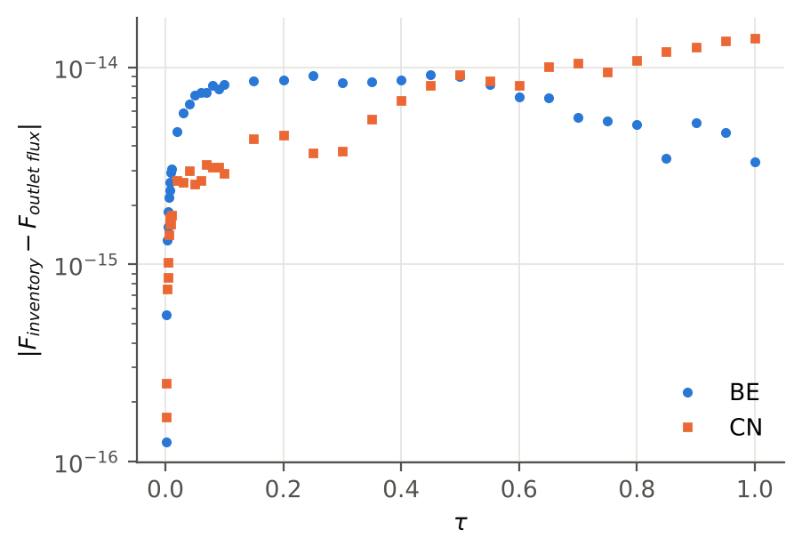

**شکل ۱-۶.** محور افقی $\tau$ و محور عمودی اختلاف مطلق کسر رهایش محاسبه‌شده از داروی باقی‌مانده و از انتگرال شار خروجی است. نقاط آبی اویلر پسرو و نارنجی کرانک–نیکلسون هستند. نتیجه: اختلاف در حد $10^{-14}$ است، یعنی گسسته‌سازی دقیقاً پایستار است و هیچ دارویی در مرکز یا مرز گم یا تولید نمی‌شود.

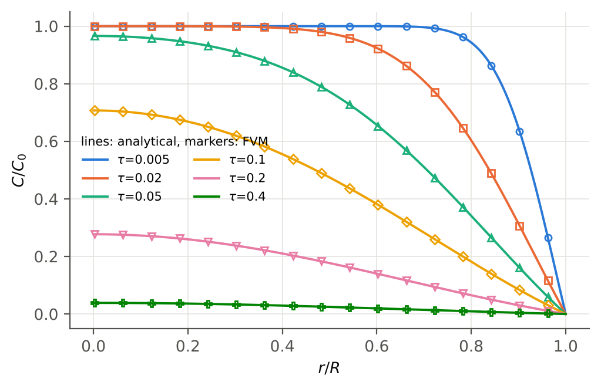

**شکل ۱-۷.** محور افقی $r/R$ و محور عمودی $C/C_0$ است. خطوط حل تحلیلی سری و نشانه‌های توخالی FVM (N=200) هستند و هر رنگ یک زمان بی‌بعد ($\tau$ از 0.005 تا 0.4) است. نتیجه: شیب صفر در مرکز و غلظت صفر روی سطح برقرارند. بیشترین خطای نقطه‌ای در $\tau=0.005$ حدود $1.4\times10^{-4}$ و در زمان‌های بعد کمتر از $3\times10^{-5}$ است.

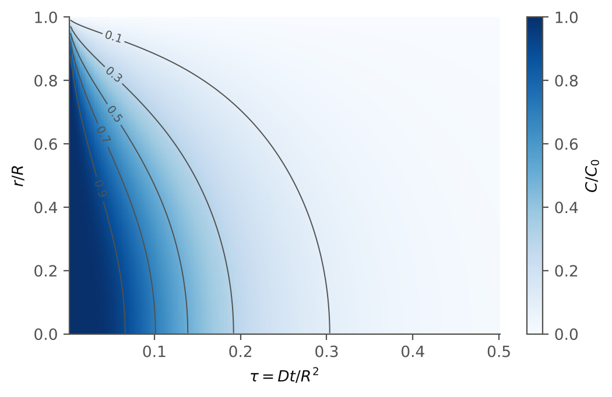

**شکل ۱-۸.** محور افقی $\tau$، محور عمودی $r/R$ و رنگ نشان‌دهنده $C/C_0$ است (نوار رنگ). منحنی‌های خاکستری خطوط هم‌غلظت 0.1 تا 0.9 هستند. نتیجه: جبهه تخلیه از سطح به سمت مرکز حرکت می‌کند و غلظت مرکز تقریباً تا $\tau\approx0.03$ دست‌نخورده می‌ماند. این همان پدیده‌ای است که در مرحله ۴ برای نمایش «غلظت درون ذره» به کار رفته است.

**جمع‌بندی مرحله ۱:** حل تحلیلی (با کنترل همگرایی) و حل FVM مستقل یکدیگر را تأیید می‌کنند. همین دو ابزار در مراحل بعد استفاده شده‌اند: ارزیاب تحلیلی برای برازش و FVM برای مدل‌های با $D$ متغیر.

# ۲. دیتاست ممیزی‌شده رهایش (ورودی مرحله برازش)

## ۲-۱. چرا دیتاست جدید ساخته شد

شیت «04_داده‌های_عددی» فایل اکسل فقط اندازه‌ها، ثابت‌های تجربی، نقاط منفرد و بازه‌ها را دارد. شیت «06» هم صریحاً می‌گوید منحنی کامل زمان–رهایش برای مقالات کلیدی رقومی‌سازی نشده است. بنابراین برای برازش، داده از PDFهای پیوست استخراج شد. هر نقطه یک ردیف مستقل با مقدار، واحد، صفحه و شکل، روش و عدم‌قطعیت دارد (`data/release_dataset_audited.csv`). برچسب‌های شواهد عبارت‌اند از:

| برچسب | تعریف | عدم‌قطعیت تقریبی |
|---|---|---|
| DIRECT_FIGURE_DATA_LABEL | عدد چاپ‌شده در ردیف داده زیر شکل | گردکردن چاپی |
| VECTOR_EXTRACTED | مختصات نشانه‌ها از عملگرهای برداری PDF، کالیبره روی خطوط علامت محور | کمتر از 0.05 واحد |
| DIGITIZED_AUTO | تصویر رستری؛ کالیبراسیون خودکار روی علامت‌های محور و تشخیص رنگ یا شکل نشانه | 0.3 تا 0.6 درصد؛ 0.06 تا 0.15 mg/mL |
| DIGITIZED_VISUAL | نشانه همپوشان؛ خوانش روی شبکه کالیبره | 1 تا 2 درصد |

## ۲-۲. کیس‌ها و معیار ورود

| کیس | دارو / سامانه | فرمولاسیون برازش‌شده | شعاع مرجع (µm) | نرمال‌سازی | هشدار اصلی |
|---|---|---|---|---|---|
| C1 Jin 2023 | مورفین / GMS | 1 | 31.6 ± 4.8 | $M_t/M_\infty$ مبهم | تعارض متن (بیش از 68٪ در 72 h) با جدول (59.2٪) |
| C2 Saravanan 2011 | دیکلوفناک / GMS | GM1، GM2، GM3 | 18.9، 20.3، 22.7 (میانگین حجم–سطح؛ SD گزارش نشده) | ٪ داروی بارگذاری‌شده | — |
| C3 Kodra 2026 | کتوپروفن / GMS با تانیک‌اسید | MS/K-1، MS/K-2، MS/K-3 | 7.5 (فقط مُد حالت خشک) | ٪ داروی کپسوله‌شده | تخریب هم‌زمان |
| C4 Zhang 2023 | ونکومایسین / ژلاتین–nHA | pH 7.4، pH 6.0 | 13.7 (D50) | ٪ $M_0$ | کیسه دیالیز (مقاومت خارجی) |
| C5 Chang 2023 | جنتامایسین / GMS پساشبکه‌ای | 1.0dM-G، 2.5dM-G (0.5dM-G محدود) | 10.5 ± 4.5، 8.7 ± 3.7 | mg/mL | بارگذاری با غوطه‌وری؛ هسته توخالی |
| C6 Hu 2024 | جنتامایسین / m-EmG آزاد | net = خام − زمینه | 8.05 ± 2.4 | mg | زمینه UV بزرگ |
| C7 Lan 2017 | bFGF / GMS متخلخل و معمولی | A، B | 17.5 (فقط A) | ٪ فلورسانس کپسوله | تأخیر سیگموئیدی |
| C8 Liu 2022 | ایکاریین / GMs | GM-1، GM-2 | ندارد (فقط بازه 10 تا 110 µm) | ٪ بارگذاری | GM-3 و GM-4 پوشیده |

موارد کنارگذاشته‌شده: Lan و همکاران (پاکلی‌تاکسل، 2019)، چون خود مقاله تصریح می‌کند شرط sink برقرار نیست. نانوذرات PLGA کتوپروفن (2026)، چون پلیمر و مقیاس آن خارج از دامنه میکروسفر ژلاتینی است. سامانه‌های کامپوزیت سیمان (Hu 2024 شکل 13 و Liu 2022 شکل 1B)، چون مقاومت ماتریس دوم دارند. نقاطی که زیر نشانه سری دیگر پنهان بودند، حدس زده نشدند و با `include_in_fit = False` و دلیل ثبت شدند.

## ۲-۳. کنترل کیفیت رقومی‌سازی

| مقایسه با عدد صریح متن | متن | دیتاست |
|---|---|---|
| Kodra MS/K-3، 1 h | 37.7٪ | 37.1٪ |
| Kodra MS/K-1، 24 h | 62.1٪ | 62.3٪ |
| Kodra MS/K-2، 5 h | 84.7٪ | 84.8٪ |
| Chang 0.5 / 1.0 / 2.5dM-G، 32 d | 4.9 / 4.7 / 7.7 mg/mL | 5.03 / 4.79 / 7.72 |
| Kodra SD% در 6 h (MS/K-2 / MS/K-3) | 1345 / 379 | 1349 / 372 |
| Liu GM-2، 21 d | 95.06٪ | 94.7٪ |

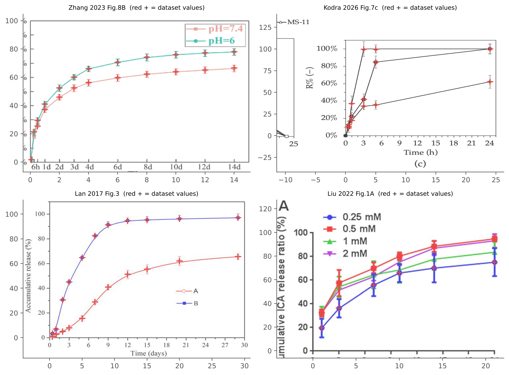

**شکل پ-۱.** هر پانل تصویر اصلی شکل مقاله است که با همان کالیبراسیون علامت‌های محور در مختصات داده قرار گرفته است. محور افقی زمان (روز یا ساعت مطابق شکل اصلی) و محور عمودی درصد رهایش است. علامت‌های + قرمز مقادیر دیتاست هستند. نتیجه: نقاط استخراج‌شده روی مرکز نشانه‌های اصلی قرار می‌گیرند. شکل‌های Chang و Hu محور زمان شکسته و نامنظم دارند و به همین دلیل با زمان‌های اسمی ستون‌ها ثبت شدند و در این پانل نیامده‌اند.

# ۳. برازش مدل نفوذ ثابت (مرحله ۲)

## ۳-۱. مدل‌ها

پارامتر اصلی $k=D_{app}/R_{ref}^{2}$ است:

$$F(t)=1-\frac{6}{\pi^{2}}\sum_{n=1}^{\infty}\frac{\exp\left(-n^{2}\pi^{2}kt\right)}{n^{2}}$$

مدل نامزد burst، فقط وقتی متن مقاله رهایش سریع اولیه را گزارش کرده است:

$$F_B(t)=b+(1-b)F(t),\qquad t>0$$

در این مدل، $b$ سهم مؤثرِ رهایش سریعِ حل‌نشده در زمان است و با هیچ جمعیت فیزیکی اثبات‌شده‌ای یکی گرفته نشده است. برای داده‌های جرمی یا غلظتی (C5، C6) و برای C1 که نرمال‌سازی آن مبهم است، دامنه $A$ هم برازش شد:

$$y(t)=A\,F(t)\quad\text{یا}\quad y(t)=A\left[b+(1-b)F(t)\right]$$

$A$ پارامتر دامنه با عدم‌قطعیت است و **$M_\infty$ نامیده نمی‌شود**. وقتی رهایش در پایان آزمون کامل نیست، $A$ فقط مقیاس منحنی برازش‌شده است. برای داده‌هایی که درصدی از مقدار اولیه مستند هستند، $A=1$ ثابت گرفته شد.

برازش به روش کمترین مربعات انجام شد (پارامترها در فضای لگاریتمی یا لجستیک، با چند حدس اولیه). خطای استاندارد از ماتریس ژاکوبی، $\mathrm{cov}=s^{2}(J^{T}J)^{-1}$، محاسبه و بازه 95٪ با توزیع t ساخته شد. مدل burst فقط وقتی «ترجیح» داده شد که کران پایین بازه 95٪ $b$ بزرگ‌تر از صفر و AICc دست‌کم 2 واحد کمتر باشد.

**تقسیم زمانی (پیش از هر برازش ثابت شد و در `results/split.json` ذخیره است):** برای هر فرمولاسیون، $\max(3,\lfloor0.6n\rfloor)$ نقطه اول به ترتیب زمان «آموزش» و بقیه «آزمون» هستند. مدل فقط روی آموزش برازش می‌شود و بدون برازش مجدد تا آخرین زمان مقاله پیش‌بینی می‌کند. خطای «ابتدایی» و «دیرهنگام» به ترتیب RMSE باقیمانده‌های برازش کامل روی 40٪ اول و 40٪ آخر نقاط است.

$$D_{app}=k\,R_{ref}^{2},\qquad \left(\frac{\sigma_{D}}{D}\right)^{2}=\left(\frac{\sigma_{k}}{k}\right)^{2}+\left(2\frac{\sigma_{R}}{R}\right)^{2}$$

هرجا SD شعاع گزارش نشده بود، باند حساسیت ±20٪ برای شعاع فرض شد و این فرض در جدول ثبت است.

## ۳-۲. جدول نتایج (مدل ترجیحی هر فرمولاسیون)

خطاها در واحد داده هستند: نقطه درصد برای داده‌های درصدی، mg/mL برای C5 و mg برای C6. F یعنی مدل پایه و FB یعنی مدل burst.

| فرمولاسیون | مدل | $k$ (h⁻¹) ± SE | $b$ ± SE | $A$ ± SE | $D_{app}$ (cm²/s) و بازه 95٪ |
|---|---|---|---|---|---|
| C1 MGM | A·F | 0.0246 ± 0.0042 | — | 0.585 ± 0.019 | 6.8e-11 (3.4e-11 تا 1.3e-10) |
| C2 GM1 | F | 5.33e-5 ± 1.3e-6 | — | — | 5.3e-14 (2.4e-14 تا 1.2e-13) |
| C2 GM2 | F | 1.31e-4 ± 4.9e-6 | — | — | 1.5e-13 (6.8e-14 تا 3.3e-13) |
| C2 GM3 | F | 2.44e-4 ± 7.3e-6 | — | — | 3.5e-13 (1.6e-13 تا 7.7e-13) |
| C3 MS/K-1 | F | 2.66e-3 ± 3.1e-4 | — | — | 4.2e-13* |
| C3 MS/K-2 | F | 1.15e-2 ± 4.4e-3 | — | — | 1.8e-12* |
| C3 MS/K-3 | F | 3.25e-2 ± 1.7e-2 | — | — | 5.1e-12* |
| C4 pH 6.0 | FB | 3.76e-4 ± 4.9e-5 | 0.14 ± 0.04 | — | 2.0e-13 (8.6e-14 تا 4.5e-13)† |
| C4 pH 7.4 | FB | 1.65e-4 ± 3.0e-5 | 0.22 ± 0.04 | — | 8.6e-14 (3.6e-14 تا 2.0e-13)† |
| C5 1.0dM-G | A·F | 0.068 ± 0.017 | — | 4.11 ± 0.12 | 2.1e-11 (3.7e-12 تا 1.2e-10) |
| C5 2.5dM-G | A·F | 0.048 ± 0.035 | — | 4.73 ± 0.45 | 9.9e-12 (1.1e-12 تا 9.0e-11) |
| C5 0.5dM-G‡ | A·F | 0.013 ± 0.010 | — | 4.52 ± 0.13 | شناسایی‌ناپذیر |
| C6 m-EmG net | A·F | 0.0158 ± 0.0032 | — | 0.334 ± 0.009 | 2.8e-12 (8.3e-13 تا 9.8e-12) |
| C7 A متخلخل | F | 7.39e-5 ± 1.5e-5 | — | — | 6.3e-14 (2.6e-14 تا 1.5e-13) |
| C7 B معمولی | F | 4.77e-4 ± 1.0e-4 | — | — | شعاع گزارش نشده |
| C8 GM-1 | F | 2.15e-4 ± 1.4e-5 | — | — | شعاع گزارش نشده |
| C8 GM-2 | F | 4.89e-4 ± 2.3e-5 | — | — | شعاع گزارش نشده |

**خطاها (در واحد داده):**

| فرمولاسیون | RMSE کل | ابتدایی | دیرهنگام | RMSE آموزش | RMSE آزمون |
|---|---|---|---|---|---|
| C1 MGM | 4.11 | 6.06 | 0.77 | 5.05 | 12.35 |
| C2 GM1 | 1.31 | 1.66 | 1.01 | 1.00 | 2.75 |
| C2 GM2 | 2.52 | 2.38 | 2.49 | 1.76 | 4.74 |
| C2 GM3 | 2.03 | 2.74 | 0.88 | 2.53 | 1.13 |
| C3 MS/K-1 | 3.36 | 0.85 | 2.94 | 1.66 | 9.01 |
| C3 MS/K-2 | 13.09 | 12.06 | 15.02 | 4.18 | 28.95 |
| C3 MS/K-3 | 18.65 | 23.01 | 8.50 | 22.79 | 10.79 |
| C4 pH 6.0 | 4.31 | 3.87 | 4.34 | 0.83 | 11.31 |
| C4 pH 7.4 | 3.85 | 4.60 | 2.82 | 2.38 | 11.07 |
| C5 1.0dM-G | 0.29 | 0.26 | 0.36 | 0.21 | 0.39 |
| C5 2.5dM-G | 1.04 | 0.36 | 1.55 | 0.20 | 1.77 |
| C5 0.5dM-G‡ | 0.23 | 0.08 | 0.38 | 0.00 | 0.36 |
| C6 m-EmG net | 0.025 | 0.019 | 0.031 | 0.018 | 0.032 |
| C7 A متخلخل | 9.81 | 12.32 | 7.65 | 5.54 | 27.14 |
| C7 B معمولی | 12.45 | 17.66 | 6.28 | 13.89 | 13.82 |
| C8 GM-1 | 2.99 | 2.65 | 2.91 | 2.41 | 3.54 |
| C8 GM-2 | 2.10 | 3.08 | 0.20 | 2.92 | 0.60 |

\* شعاع Kodra فقط مُد خشک است (قطر 15 µm). با شعاع حالت آب‌دار، که برای MS خالی 15 تا 20 µm گزارش شده است، $D_{app}$ حدود 4 تا 7 برابر بزرگ‌تر می‌شود. بنابراین این ستون فقط محدوده تقریبی را نشان می‌دهد.
† ونکومایسین در کیسه دیالیز آزموده شده است. پس $k$ مجموع مقاومت ذره و غشا است و $D_{app}$ ضریب نفوذ ذره نیست.
‡ نقاط ساعتی 0.5dM-G زیر سری‌های تیره‌تر پنهان بودند. بدون فاز اولیه، $k$ قابل تعیین نیست ($\sigma_k/k=0.77$).

**مدل burst:** در 12 فرمولاسیون از 17، برازش $b$ به مرز صفر رسید یا مدل واگرا شد. در GM3، MS/K-1 و GM-2، مقدار $b$ کوچک بود (0.015 تا 0.044) و AICc بهتر نشد. فقط در ونکومایسین شرط ترجیح برقرار شد. **هم‌بستگی پارامترها:** در ونکومایسین، هم‌بستگی $k$ با $b$ برابر 0.75− و 0.84− است. یعنی بخشی از رهایش را می‌توان یا به $b$ نسبت داد یا به $k$ بزرگ‌تر. در C5 و C6، هم‌بستگی $k$ با $A$ بین 0.39− و 0.47− است.

## ۳-۳. نمودارها و تفسیر هر کیس

راهنمای مشترک همه شکل‌های ۲-۱ تا ۲-۸: در پانل بالا، محور افقی زمان (ساعت) و محور عمودی رهایش تجمعی در واحد مقاله است. نشانه‌های توپر نقاط آموزش، نشانه‌های توخالی نقاط آزمون، و خط عمودی نقطه‌چین مرز تقسیم آموزش/آزمون هر فرمولاسیون هستند. خط پیوسته برازش روی کل بازه و خط‌چین برازش فقط روی آموزش است که بدون برازش مجدد تا آخرین زمان امتداد یافته است. علامت × خاکستری نقطه‌ای است که با دلیل ثبت‌شده از برازش کنار گذاشته شد. پانل پایین باقیمانده (داده منهای برازش کامل) را در همان واحد نشان می‌دهد. هر رنگ یک فرمولاسیون است.

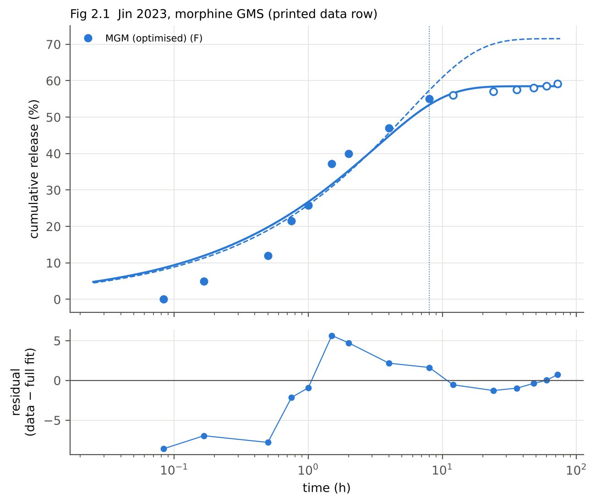

**شکل ۲-۱ (مورفین، C1).** محور افقی لگاریتمی است. پارامترهای برازش‌شده $k$ و $A$ هستند. الگوی علامت باقیمانده‌ها سیستماتیک است (پنج منفی، چهار مثبت، دوباره منفی): رهایش اولیه از شکل فیکی تندتر شروع و زودتر متوقف می‌شود. در 5 دقیقه، 0٪ و در 90 دقیقه، 37٪ رهایش ثبت شده است. فیک فقط تخت‌شدن پس از 8 ساعت را با $A=0.585$ توصیف می‌کند (RMSE دیرهنگام 0.77). مدل آموزش‌دیده روی 8 ساعت اول، پیش‌بینی آزمون را 12.3 نقطه درصد اشتباه می‌کند. چون متن مقاله رهایش «بیش از 68٪ در 72 ساعت» را گزارش کرده و جدول شکل 59.2٪ را، نمی‌توان $A$ را به داروی غیرقابل‌رهایش نسبت داد.

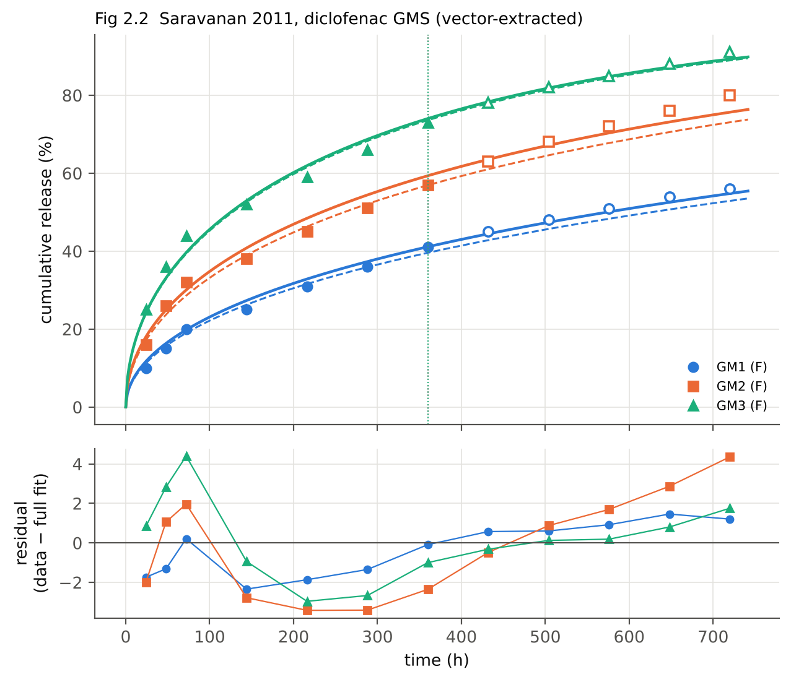

**شکل ۲-۲ (دیکلوفناک، C2).** محور افقی خطی (ساعت، تا 720 h یعنی 30 روز) است و فقط $k$ برازش شده است. فیک ثابت در کل 30 روز پاسخگوست: RMSE برابر 1.3 تا 2.5 درصد و خطای آزمون 1.1 تا 4.7 درصد. باقیمانده‌ها در روزهای 6 تا 12 منفی و در روزهای 21 تا 30 مثبت‌اند، یعنی رهایش دیرهنگام کمی از فیک تندتر است. این انحراف برای GM2 در روز 30 به 4.4 نقطه می‌رسد. $k$ با بار دارو 4.6 برابر شده است (GM1 به GM3)، در حالی که شعاع فقط 20٪ تغییر کرده است. نتیجه: $D_{app}$ به فرمولاسیون وابسته است و یک $D$ واحد برای همه بارها وجود ندارد. سازوکار این وابستگی (مثلاً تخلخل ناشی از انحلال دارو) با این داده قابل اثبات نیست.

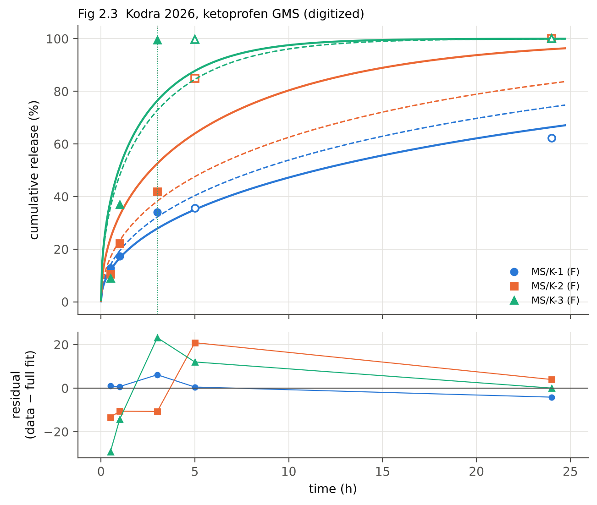

**شکل ۲-۳ (کتوپروفن، C3).** محور افقی خطی (0 تا 24 h) است و فقط $k$ برازش شده است. با 5 نقطه، تقسیم 3 آموزش و 2 آزمون است. در MS/K-1، فیک تا 1 ساعت در حد خطای رقومی‌سازی است، ولی مدل آموزش‌دیده رهایش 24 ساعت را 75٪ پیش‌بینی می‌کند در حالی که 62٪ اندازه‌گیری شده است (خطای آزمون 9.0). در MS/K-2، جهش 42٪ به 85٪ بین 3 و 5 ساعت با هیچ $k$ ثابتی سازگار نیست (RMSE 13.1، آزمون 29). در MS/K-3، رهایش تقریباً کامل در 3 ساعت رخ داده و تعداد نقاط برای تشخیص شکل کافی نیست. نتیجه: هرچه اتصال عرضی کمتر است، فاصله از فیک بیشتر است. این با داده تخریب همان مقاله (DR%) هم‌جهت است، ولی از منحنی رهایش به‌تنهایی اثبات نمی‌شود.

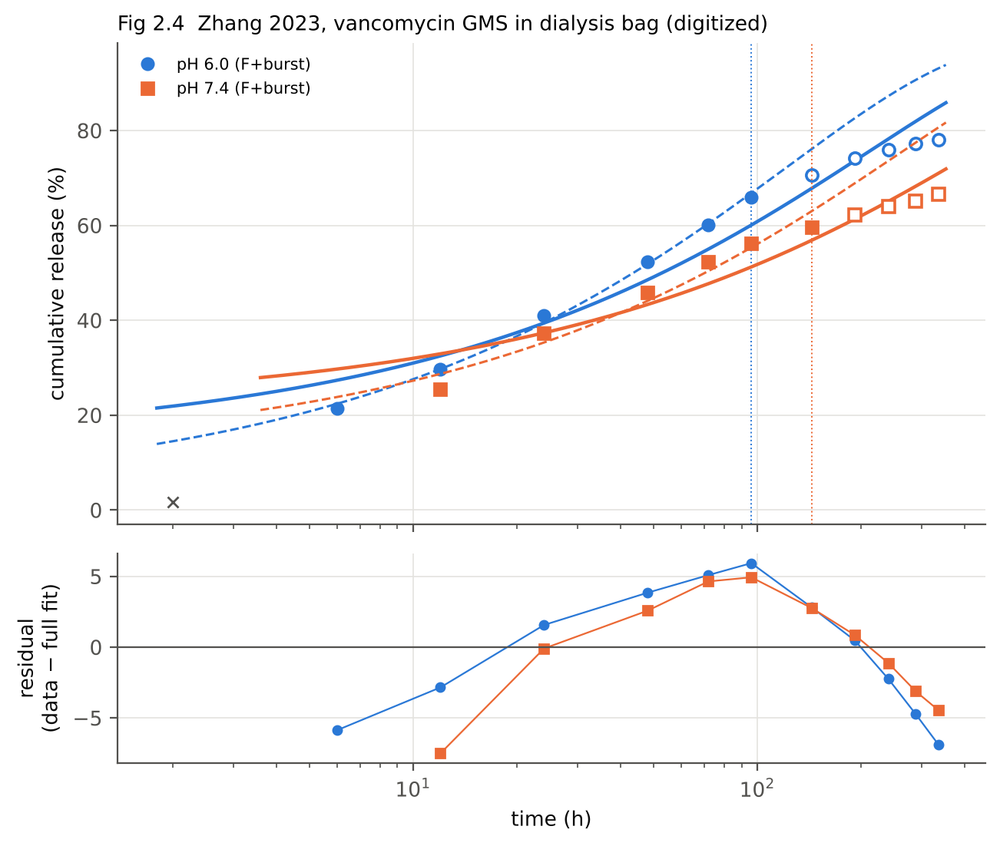

**شکل ۲-۴ (ونکومایسین، C4).** محور افقی لگاریتمی است و $k$ و $b$ برازش شده‌اند. مدل burst ترجیح آماری گرفت ($b=0.14$ در pH 6.0 و $0.22$ در pH 7.4). اما نقطه کنارگذاشته‌شده × (خوشه نشانه‌های 0.5 تا 2 ساعت روی محور، حدود 1.6٪) نشان می‌دهد در ساعت‌های اول تقریباً رهایشی وجود ندارد. پس $b$ تصحیح شکل است، نه رهایش انفجاری واقعی. این تأخیر با غشای دیالیز سازگار است. باقیمانده‌ها S شکل‌اند و داده‌ها در 14 روز زیر 80٪ تخت می‌شوند، در حالی که مدل به 100٪ میل می‌کند. خطای آزمون حدود 11 نقطه است. نسبت $k$ در pH 6 به pH 7.4 حدود 2.3 است، ولی بخشی از این تفاوت ممکن است به غشا مربوط باشد.

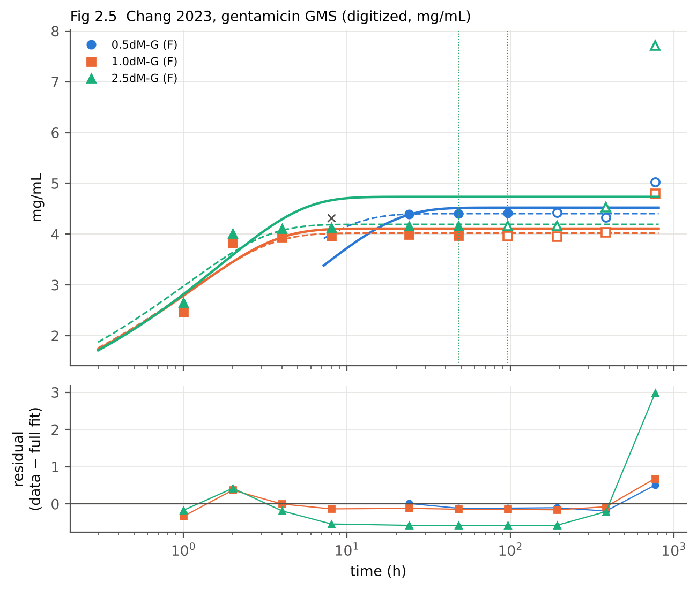

**شکل ۲-۵ (جنتامایسین، C5).** محور افقی لگاریتمی، محور عمودی mg/mL و پارامترهای برازش‌شده $k$ و $A$ هستند. فیک، صعود تا 2 ساعت و تخت‌شدن تا روز 16 را با خطای حدود 0.3 mg/mL توصیف می‌کند. در 2.5dM-G، رهایش ثانویه پس از روز 16 (از 4.5 به 7.7 mg/mL) باقیمانده 3+ mg/mL ایجاد می‌کند و $A$ برازش کامل را بالا می‌کشد. پس فیک تا روز 16 پاسخگوست و پس از آن نیست. خود مقاله این رهایش ثانویه را به فروپاشی ساختار نسبت داده است. بارگذاری با غوطه‌وری (توزیع اولیه غیریکنواخت محتمل) و هسته توخالی دو فرض مدل پایه را نقض می‌کنند. بنابراین $D_{app}$ این کیس فقط یک مقیاس است.

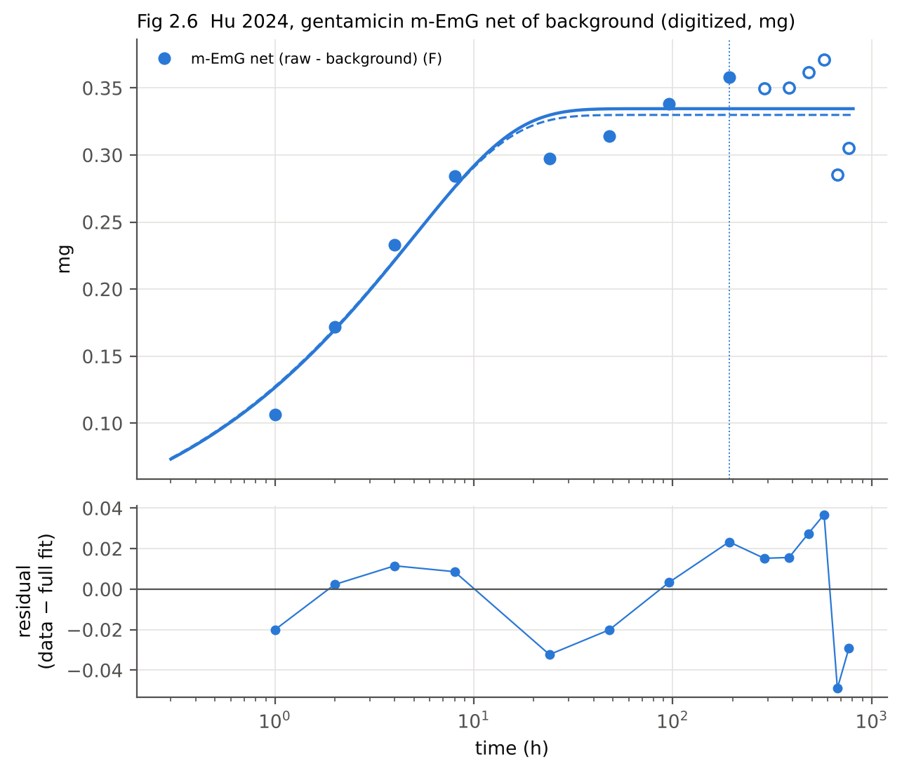

**شکل ۲-۶ (جنتامایسین، C6).** محور عمودی mg است و سری net برابر تفاضل m-EmG و زمینه m-Em است، طبق دستور متن مقاله. پارامترها $k$ و $A$ هستند. RMSE حدود 0.025 mg است، یعنی حدود 7٪ دامنه. باقیمانده مثبت در روزهای 4 تا 24 و منفی در 28 تا 32، از افزایش سیگنال زمینه (محصولات تخریب در UV 193 نانومتر) اثر می‌پذیرد. خطای ترکیبی دو منحنی رقومی‌شده هم وجود دارد. نتیجه: این کیس برای کالیبراسیون $D$ مناسب نیست و فقط مقیاس زمانی تقریبی می‌دهد.

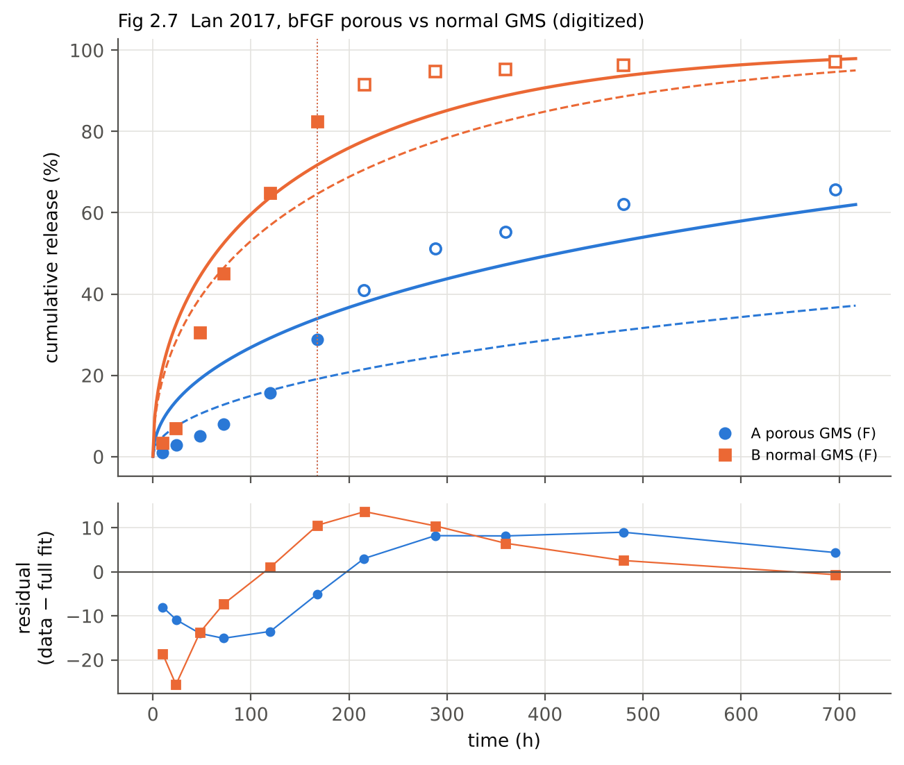

**شکل ۲-۷ (bFGF، C7).** محور افقی خطی است و فقط $k$ برازش شده است. هر دو فرمولاسیون شروع تأخیری و نقطه عطف دارند (سیگموئیدی). فیک با غلظت اولیه یکنواخت همیشه از شروع، شیب نزولی دارد و نمی‌تواند نقطه عطف بسازد. نتیجه: RMSE برابر 9.8 و 12.5 و خطای آزمون 27 و 14 نقطه است. شکل منحنی با توزیع اولیه غیریکنواخت، آب‌گیری آهسته یا رهایش کنترل‌شده با اتصال یا تخریب سازگار است. تعیین اینکه کدام‌یک، به داده مستقل نیاز دارد.

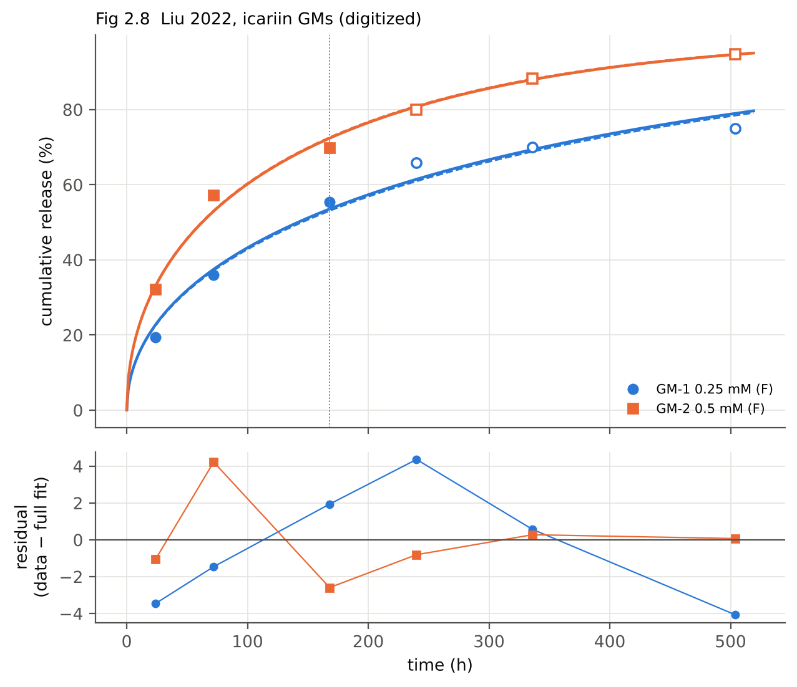

**شکل ۲-۸ (ایکاریین، C8).** محور افقی خطی (0 تا 504 h) است و فقط $k$ برازش شده است. RMSE برابر 3.0 و 2.1 درصد و خطای آزمون 3.5 و 0.6 درصد است. فیک ثابت در کل 21 روز کافی است. چون فقط بازه اندازه (10 تا 110 µm) گزارش شده، $D_{app}$ محاسبه نشد.

## ۳-۴. فیک در کدام بازه پاسخگوست؟

| وضعیت | کیس‌ها | شواهد |
|---|---|---|
| کل بازه مقاله | C2 (30 روز)، C8 (21 روز) | RMSE کمتر یا مساوی 3٪، خطای آزمون کمتر یا مساوی 4.7٪، $b$ پشتیبانی نشد |
| فقط بخشی از بازه | C5 (تا روز 16)، C1 (فقط تخت‌شدن، با $A$ آزاد)، C3 MS/K-1 (تا حدود 5 h) | انحراف دیرهنگام یا شکل اولیه غیرفیکی |
| ناکافی | C3 MS/K-2 و MS/K-3، C4، C7، C6 | باقیمانده سیستماتیک، شروع تأخیری، تخت‌شدن زیر 100٪ یا آلودگی سیگنال |

# ۴. Abbasi و همکاران (2008) و آمادگی داده برای نفوذ وابسته به آب (مرحله ۳)

## ۴-۱. وضعیت منبع

مرجع: Abbasi, Eslamian & Rousseau (2008)، *Drug Delivery* 15(7)، DOI: 10.1080/10717540802321628.

- **متن کامل در این جلسه در دسترس نبود.** در فهرست پیوست‌ها نیست و صفحه ناشر از این محیط باز نشد. بنابراین تعریف $C_w$ (جرم آب بر حجم خیس، بر حجم خشک یا بر جرم خشک)، واحد آن، شرایط مرزی و اینکه تغییر حجم یا مرز متحرک مدل شده یا نه، **تأییدنشده** باقی می‌ماند.
- آنچه موجود است، ممیزی اکسل (شیت 04، ردیف‌های D060 تا D091، «Table II») است: هشت فرمولاسیون هیدروژل **استوانه‌ای** ژلاتین و مالتودکسترین (قطر 12.5 mm، ارتفاع 10 mm، اتصال با جنیپین، pH 1.5). این مقادیر در `results/abbasi2008_workbook_values.csv` با برچسب منشأ آمده‌اند.
- رابطه Fujita به مقاله عبدخدایی نسبت داده نشده است. کارهای عبدخدایی و وو در پروپوزال فقط برای میکروسفرهای تبادل یون ارجاع شده‌اند.

رابطه نوع Fujita با نمادگذاری پروژه ($i=w$ برای آب، $i=d$ برای دارو):

$$D_i(C_w)=D_{i,eq}\exp\left[-\beta_i\left(1-\frac{C_w}{C_{w,eq}}\right)\right]$$

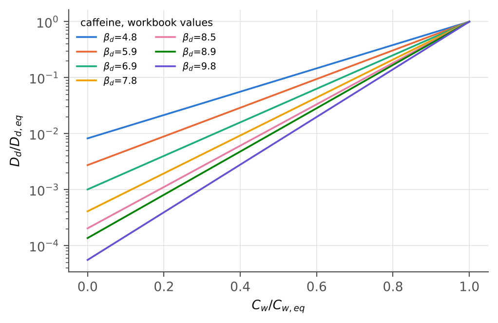

**شکل ۳-۱.** محور افقی $C_w/C_{w,eq}$ و محور عمودی $D_d/D_{d,eq}$ (لگاریتمی) است. هر رنگ یک مقدار $\beta_d$ از جدول اکسل است (کافئین، 4.8 تا 9.8). پارامتری برازش نشده است و این شکل فقط تصویر تابع است. نتیجه: با این مقادیر، $D$ دارو بین حالت خشک و تعادلی 100 تا 18000 برابر تغییر می‌کند. پس اگر آب‌گیری کند باشد، اثر آن بر رهایش نمی‌تواند ناچیز باشد. اما این مقادیر برای هندسه استوانه‌ای میلی‌متری اندازه‌گیری شده‌اند و نباید مستقیم به میکروسفر منتقل شوند.

## ۴-۲. قاعده تبدیل

$Q$ جرمی به‌طور خودکار جای $C_w$ گذاشته نشد. فقط اگر $C_w$ به‌صورت جرم آب بر حجم خیس تعریف شده باشد و داده متناظر موجود باشد:

$$C_w(t)=\frac{m_w(t)}{V_{wet}(t)},\qquad Q=\frac{m_w}{m_{dry,0}}\ \Rightarrow\ C_w(t)=\frac{Q(t)\,m_{dry,0}}{V_{wet}(t)}$$

این تبدیل به $V_{wet}(t)$ اندازه‌گیری‌شده نیاز دارد که در هیچ کیسی وجود ندارد.

## ۴-۳. جدول آمادگی داده

| کیس | ۱. $C_w$ یا داده محاسبه | ۲. همان فرمولاسیون و محیط | ۳. حجم یا شعاع در زمان | ۴. جرم شبکه ثابت | ۵. پوشش مرحله گذرای اولیه | پارامتر قابل تعیین |
|---|---|---|---|---|---|---|
| C1 مورفین | خیر | — | خیر | گزارش نشده | خیر | فقط $k$ |
| C2 دیکلوفناک | خیر | — | خیر | گزارش نشده | خیر | $k$ |
| C3 کتوپروفن | جزئی: فقط SD% جرمی، بدون حجم خیس | **بله** (MS/K-1..3، PBS 7.4، 37°C) | خیر (فقط یک توزیع اندازه آب‌دار برای MS خالی) | **خیر** (DR% در 24 h به حدود صفر می‌رسد؛ SD پس از اوج افت می‌کند) | **خیر** (اولین نقطه 1 h؛ 17 تا 37٪ دارو تا آن زمان رها شده) | $k$؛ (k_eq، β) شاخص جرمی، ضعیف |
| C4 ونکومایسین | جزئی: «swelling rate» میکروسفر بدون دارو | خیر (M در برابر VM) | خیر | گزارش نشده | فقط برای M (15 دقیقه) | $k$ (همراه غشا) |
| C5 جنتامایسین | خیر | — | خیر | خیر (کاهش وزن dM) | خیر | $k$، $A$ |
| C6 جنتامایسین | خیر (تغییر وزن m-Em) | خیر | خیر | خیر | خیر | $k$، $A$ |
| C7 bFGF | خیر | — | خیر | گزارش نشده | خیر | $k$ |
| C8 ایکاریین | خیر | — | خیر | گزارش نشده | خیر | $k$ |

**پارامترهای قابل تعیین:** با داده موجود، $D_{w,eq}$، $\beta_w$، $D_{d,eq}$ و $\beta_d$ برای هیچ کیسی قابل تعیین نیستند و فقط $k$ (و در داده‌های واحددار، $A$) شناسایی‌پذیر است. داده‌های ناقص با آب‌گیری فرضی کامل نشدند.

## ۴-۴. انتخاب مستدل: شعاع ثابت یا مرز متحرک

در هیچ فرمولاسیونی شعاع یا حجم در طول زمان اندازه‌گیری نشده است. علاوه بر این، اگر تورم یکنواخت باشد، منحنی رهایش فقط به $\int D/R^2\,dt$ وابسته است و اثر رشد شعاع از اثر تغییر $D$ جدا نمی‌شود (بخش ۵-۵). بنابراین **مدل شعاع ثابت با $R_{ref}$ و عدم‌قطعیت آن انتخاب شد**. مدل مرز متحرک فقط وقتی قابل دفاع است که $R(t)$ یا $V_{wet}(t)$ برای همان فرمولاسیون اندازه‌گیری شود.

# ۵. مقایسه مدل نفوذ ثابت و مدل وابسته به آب‌گیری (مرحله ۴)

## ۵-۱. تعریف رهایش

$$M_d(t)=4\pi\int_{0}^{R(t)}C_d(r,t)\,r^{2}\,dr,\qquad F(t)=1-\frac{M_d(t)}{M_d(0)}$$

این تعریف نسبت به **جرم اولیه** است. در C2 (درصد داروی بارگذاری‌شده)، C3 ($K_r/K_e$، داروی کپسوله‌شده)، C4 ($M_0$ بارگذاری‌شده) و C8 (کل داروی بارگذاری‌شده)، نرمال‌سازی مقاله با این تعریف یکسان است. در C1، مقاله از $M_t/M_\infty$ استفاده کرده است. اگر $M_\infty$ مقدار نهایی رهاشده باشد، با جرم اولیه یکی نیست و تخت‌شدن در 59٪ نشان می‌دهد این دو برابر نیستند. در C5 و C6، داده غلظت یا جرم است و بدون بار کل، $F$ قابل محاسبه نیست. بنابراین این کیس‌ها با دامنه $A$ آمده‌اند.

## ۵-۲. پیاده‌سازی مدل وابسته به آب‌گیری و صحت‌سنجی آن

مدل کامل (شعاع ثابت، بی‌بعد با $D_{d,eq}$):

$$\frac{\partial\theta}{\partial\tau}=\frac{1}{x^2}\frac{\partial}{\partial x}\left[x^2\frac{D_{w,eq}}{D_{d,eq}}e^{-\beta_w(1-\theta)}\frac{\partial\theta}{\partial x}\right],\qquad \frac{\partial c}{\partial\tau}=\frac{1}{x^2}\frac{\partial}{\partial x}\left[x^2e^{-\beta_d(1-\theta)}\frac{\partial c}{\partial x}\right],\qquad \theta=\frac{C_w}{C_{w,eq}}$$

همان هسته FVM صحت‌سنجی‌شده با اویلر پسرو به کار رفت. ضریب آب با تکرار پیکارد خطی شد. کنترل‌ها: با $\beta_d=0$ اختلاف با حل تحلیلی $5.2\times10^{-4}$ است (اویلر پسرو، N=60، $\Delta\tau=2\times10^{-4}$) و موازنه جرم $8.5\times10^{-15}$.

## ۵-۳. مقایسه روی داده واقعی (فقط C3، مدل نامزد)

چون $C_w$ قابل محاسبه نیست، مدل وابسته به آب‌گیری با **شاخص جرمی** $\theta_Q(t)=SD(t)/SD_{max}$ اجرا شد. این شاخص صریحاً $C_w/C_{w,eq}$ **نیست**:

$$D(t)=D_{eq}\exp\left[-\beta\left(1-\theta_Q(t)\right)\right]\ \Rightarrow\ F(t)=F_{Fick}\left(\int_0^t k_{eq}\,e^{-\beta(1-\theta_Q(s))}\,ds\right)$$

چون $\theta_Q$ فقط تابع زمان است، $D$ در فضا یکنواخت است و حل دقیق با نگاشت زمان به دست می‌آید. فاصله 0 تا 1 ساعت اندازه‌گیری نشده است، پس دو فرض «خطی» و «پله‌ای» مقایسه شدند. افت SD پس از اوج را خود مقاله به کاهش جرم نسبت داده است، پس نسخه «یکنوا» (بیشینه تجمعی) هم آزموده شد. تقسیم آموزش/آزمون همان تقسیم مرحله ۲ است (3 نقطه آموزش و 2 آزمون).

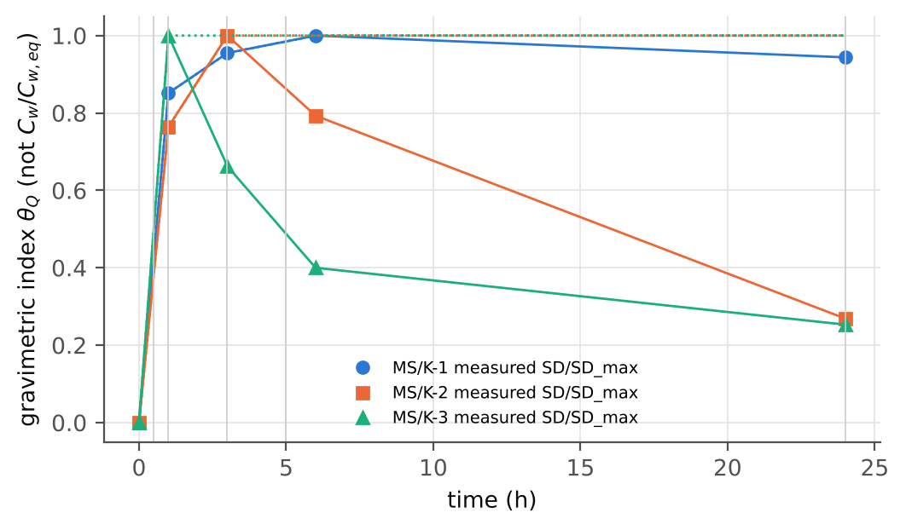

**شکل ۴-۲.** محور افقی زمان (ساعت) و محور عمودی شاخص جرمی $\theta_Q$ است. نشانه‌ها SD/SD_max اندازه‌گیری‌شده هستند (رنگ برای هر فرمولاسیون)، خط پیوسته درون‌یابی خطی و خط نقطه‌چین نسخه یکنواست. خطوط عمودی خاکستری زمان‌های نمونه‌برداری رهایش‌اند. پارامتری برازش نشده است. نتیجه: اولین نقطه تورم پس از دو نقطه اول رهایش (0.5 و 1 ساعت) قرار دارد و شاخص در MS/K-2 و MS/K-3 پس از اوج سقوط می‌کند. پس SD در این سامانه جذب آب و کاهش جرم را با هم اندازه می‌گیرد.

| فرمولاسیون | مدل | پارامترها | RMSE کل | RMSE آزمون | AICc (کل) | $\beta$ (بازه 95٪) / هم‌بستگی $k$–$\beta$ |
|---|---|---|---|---|---|---|
| MS/K-1 | C: $D$ ثابت | 1 | 3.36 | 9.01 | −30.6 | — |
| MS/K-1 | W-Q خطی | 2 | 3.36 | 13.42 | −23.9 | $\beta\to0$ (مرز) |
| MS/K-1 | W-Q پله‌ای | 2 | 3.36 | 21.73 | −23.9 | $\beta\to0$ (مرز) |
| MS/K-2 | C: $D$ ثابت | 1 | 13.09 | 28.95 | −17.0 | — |
| MS/K-2 | W-Q خطی | 2 | 8.99 | 24.22 | −14.1 | 3.2 (−4.2 تا 10.6) / 0.81 |
| MS/K-2 | W-Q پله‌ای یکنوا | 2 | 5.00 | 17.20 | −20.0 | 12.1 (1.3 تا 22.8) / 0.73 |
| MS/K-3 | C: $D$ ثابت | 1 | 18.65 | 10.79 | −13.5 | — |
| MS/K-3 | W-Q خطی یکنوا | 2 | 2.15 | 0.02 | −28.4 | 7.7 (3.1 تا 12.2) / 0.75 |
| MS/K-3 | W-Q پله‌ای | 2 | 18.65 | 10.79 | −6.8 | $\beta\to0$ (مرز) |

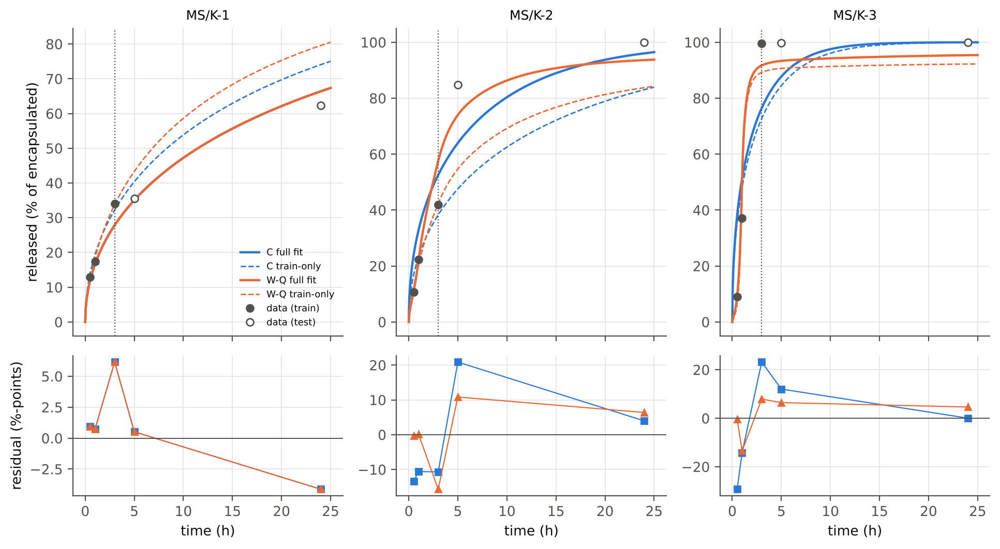

**شکل ۴-۱.** در پانل‌های بالا، محور افقی زمان (ساعت) و محور عمودی رهایش (درصد داروی کپسوله) است. آبی مدل $D$ ثابت (C) و نارنجی مدل نامزد W-Q با درون‌یابی خطی است. خط پیوسته برازش کامل و خط‌چین برازش آموزش است. دایره توپر آموزش، دایره توخالی آزمون و خط نقطه‌چین مرز تقسیم است. پانل‌های پایین باقیمانده را در نقطه درصد نشان می‌دهند (مربع C، مثلث W-Q). پارامترها: $k$ برای C، و $k_{eq}$ و $\beta$ برای W-Q. نتیجه‌ای که واقعاً می‌توان گرفت:

۱. در MS/K-1، افزودن وابستگی به آب‌گیری هیچ بهبودی نمی‌دهد ($\beta$ به صفر می‌رسد) و پیش‌بینی آزمون را بدتر می‌کند.
۲. در MS/K-2 و MS/K-3، بهبود فقط در برخی نسخه‌ها دیده می‌شود و علامت آن با فرض شکل آب‌گیری در 0 تا 1 ساعت، که اندازه‌گیری نشده، عوض می‌شود.
۳. هم‌بستگی $k$ با $\beta$ بین 0.7 و 0.94 است. با 3 نقطه آموزش و 2 پارامتر، فقط یک درجه آزادی باقی می‌ماند.

پس با این داده، **مدل وابسته به آب‌گیری مدل نامزد است و پشتیبانی داده ندارد**. بهبود AICc در MS/K-3 شاهد مکانیسم تورم محسوب نمی‌شود.

## ۵-۴. شناسایی‌پذیری: آیا منحنی رهایش به‌تنهایی می‌تواند $\beta$ را تعیین کند؟

این آزمون **نظری و با داده مصنوعی** است و نتیجه آن هیچ ادعایی درباره داده تجربی نیست. مدل کامل آب و دارو با مقادیر اکسل ($\beta_w=6.8$، $\beta_d=8.5$، $D_w/D_d=1.16$) و $\theta_0=0.1$ اجرا شد. نمونه‌برداری با الگوی زمانی دیکلوفناک (12 نقطه) و Kodra (5 نقطه) انجام شد. سپس مدل $D$ ثابت روی آن برازش شد.

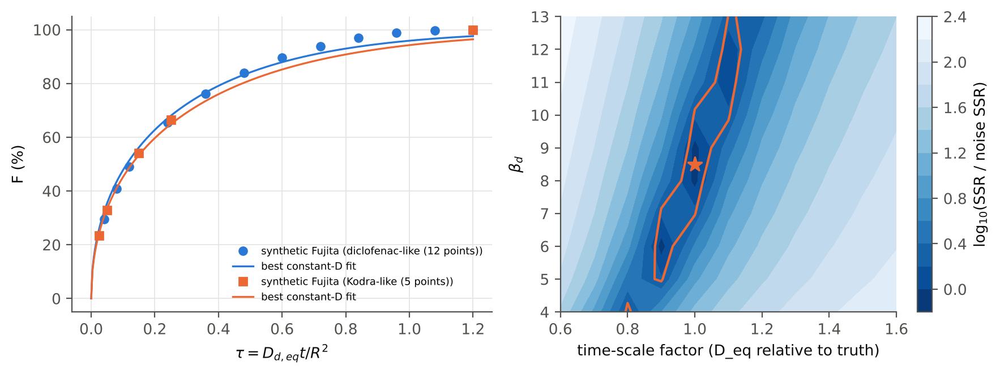

**شکل ۴-۳.** در پانل چپ، محور افقی $\tau=D_{d,eq}t/R^2$ و محور عمودی $F$ (٪) است. نشانه‌ها داده مصنوعی مدل Fujita و خطوط بهترین برازش $D$ ثابت هستند. در پانل راست، محور افقی ضریب مقیاس زمانی (نسبت $D_{eq}$ به مقدار درست) و محور عمودی $\beta_d$ است. رنگ لگاریتم نسبت مجموع مربعات خطا به مجموع مربعات نویز 1٪ است، منحنی نارنجی مرز «دو برابر نویز» و ستاره مقدار درست است. پارامترهای برازش‌شده: $k$ در پانل چپ و ($D_{eq}$، $\beta_d$) روی شبکه در پانل راست (پارامترهای آب معلوم فرض شدند).

نتایج:

- مدل $D$ ثابت داده Fujita را با RMSE برابر 2.4٪ (12 نقطه) و 1.6٪ (5 نقطه) توصیف می‌کند. این در حد SE تجربی گزارش‌شده (حدود 2٪) است.
- $D_{app}$ حاصل حدود 0.25 تا 0.28 برابر $D_{d,eq}$ است، یعنی فیک ثابت ضریب تعادلی را حدود 4 برابر کمتر تخمین می‌زند، بدون اینکه خطای برازش این را نشان دهد.
- در پانل راست، یک «دره» کشیده از ($0.9$، $\beta=5$) تا ($1.1$، $\beta=13$) دیده می‌شود. یعنی حتی با پارامترهای آب معلوم، $\beta_d$ از رهایش به‌تنهایی شناسایی‌پذیر نیست.

## ۵-۵. تفکیک اثر هندسی تغییر شعاع از اثر تغییر نفوذ

اگر تورم یکنواخت (affine) باشد و دارو در مختصات مرجع ذره ردیابی شود، کمیت $m=C\,(R/R_0)^3$ از معادله نفوذ در $\xi=r/R(t)$ با ضریب $D/R(t)^2$ پیروی می‌کند. در نتیجه رهایش فقط تابع زمان مؤثر زیر است:

$$\tau_{eff}(t)=\int_0^t\frac{D(s)}{R(s)^2}\,ds$$

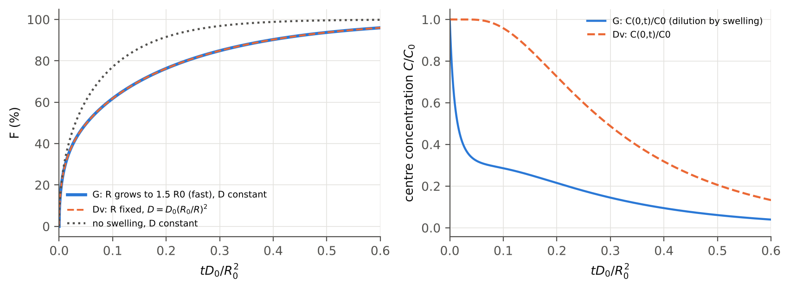

**شکل ۴-۴.** محور افقی زمان بی‌بعد $tD_0/R_0^2$ است. محور عمودی پانل چپ $F$ (٪) و محور عمودی پانل راست غلظت مرکز $C/C_0$ است. آبی سناریوی G (شعاع به 1.5 برابر می‌رسد و $D$ ثابت است)، نارنجی خط‌چین سناریوی Dv (شعاع ثابت و $D=D_0(R_0/R)^2$) و نقطه‌چین خاکستری حالت بدون تورم است. پارامتری برازش نشده است. نتیجه: منحنی رهایش دو سناریو دقیقاً یکسان است (اختلاف صفر طبق اتحاد بالا)، در حالی که غلظت درون ذره کاملاً متفاوت است، چون در G رقیق‌شدن رخ می‌دهد. **از منحنی رهایش به‌تنهایی نمی‌توان اثر مستقل تورم هندسی یا تغییر $D$ را ادعا کرد.** برای تفکیک، اندازه‌گیری مستقل $R(t)$ یا غلظت درون ذره لازم است.

## ۵-۶. غلظت–زمان در مکان‌های مشخص داخل ذره

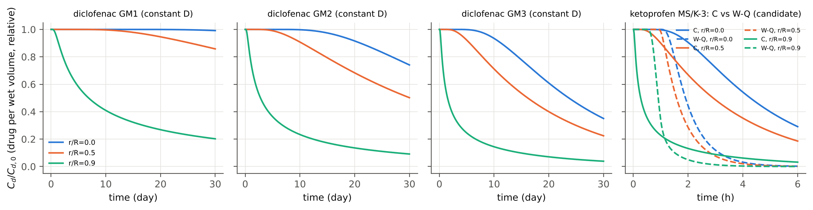

**شکل ۴-۵.** محور افقی زمان فیزیکی است (روز برای دیکلوفناک، ساعت برای کتوپروفن). محور عمودی $C_d/C_{d,0}$ است، یعنی غلظت داروی متحرک بر واحد حجم ذره نسبت به غلظت اولیه، بی‌بعد. رنگ‌ها مکان‌ها هستند: آبی $r/R=0$، نارنجی $r/R=0.5$ و سبز $r/R=0.9$. سه پانل اول مدل $D$ ثابت برازش‌شده GM1 تا GM3 را نشان می‌دهند. پانل چهارم MS/K-3 را با C (پیوسته) و W-Q یکنوای خطی (خط‌چین) مقایسه می‌کند. نتیجه: در GM1، مرکز ذره پس از 30 روز هنوز حدود 99٪ غلظت اولیه را دارد، در حالی که لایه بیرونی ($r/R=0.9$) زودتر تخلیه می‌شود. این یعنی رهایش 56٪ عمدتاً از پوسته بیرونی آمده است. در MS/K-3، دو مدلی که منحنی رهایش نزدیکی دارند، تاریخچه غلظت درونی بسیار متفاوتی پیش‌بینی می‌کنند. این‌ها پیش‌بینی مدل‌اند و اندازه‌گیری نشده‌اند.

## ۵-۷. زمان رسیدن به 50٪ رهایش ($t_{50}$)

$t_{50}$ فقط برای کیس‌هایی گزارش شد که نرمال‌سازی آن‌ها نسبت به مقدار اولیه مستند است، داده از 50٪ عبور کرده است، و $t_{50}$ مدل درون بازه عبور مشاهده‌شده قرار دارد.

| فرمولاسیون | $t_{50}$ مدل (h) و بازه 95٪ | بازه عبور در داده (h) | وضعیت |
|---|---|---|---|
| C2 GM1 | 574 (548 تا 602) ≈ 23.9 روز | 504 تا 576 | گزارش‌پذیر |
| C2 GM2 | 233 (217 تا 252) ≈ 9.7 روز | 216 تا 288 | گزارش‌پذیر |
| C2 GM3 | 125 (118 تا 133) ≈ 5.2 روز | 72 تا 144 | گزارش‌پذیر |
| C8 GM-1 | 142 (126 تا 163) | 72 تا 168 | گزارش‌پذیر |
| C8 GM-2 | 62.5 (57 تا 69) | 24 تا 72 | گزارش‌پذیر |
| C3 MS/K-1 | 11.5 (9.4 تا 14.8) | 5 تا 24 | درون بازه، ولی خطای آزمون 9 نقطه است؛ با احتیاط |
| C3 MS/K-2، MS/K-3 | خارج از بازه داده | 3 تا 5 / 1 تا 3 | فقط بازه داده |
| C4 pH 6.0، pH 7.4 | خارج از بازه داده | 24 تا 48 / 48 تا 72 | فقط بازه داده |
| C7 A، B | خارج از بازه داده | 216 تا 288 / 72 تا 120 | فقط بازه داده |
| C1، C5، C6 | — | — | نرمال‌سازی نسبت به جرم اولیه نیست؛ گزارش نمی‌شود |

## ۵-۸. کدام مدل پشتیبانی داده دارد؟

| مدل | وضعیت | دلیل |
|---|---|---|
| فیک کروی، $D$ ثابت، شعاع ثابت | **پشتیبانی‌شده** برای C2 و C8 در کل بازه؛ برای C5 تا روز 16 | خطای آزمون کم، باقیمانده بدون الگوی شدید، پارامتر یکتا |
| فیک + burst ($b$) | **نامزد**؛ فقط در C4 ترجیح آماری دارد | با نقاط ساعت‌های اول C4 ناسازگار است؛ در بقیه $b\to0$ |
| $D$ وابسته به آب‌گیری (Fujita با $C_w$) | **قابل آزمون نیست** | $C_w$ و $V_{wet}(t)$ در هیچ کیسی موجود نیست |
| $D$ وابسته به شاخص جرمی تورم (W-Q) | **نامزد** | بهبود وابسته به فرض 0 تا 1 ساعت؛ $\beta$ ضعیف شناسایی‌پذیر؛ آزمون MS/K-1 بدتر |
| مرز متحرک | **پشتیبانی نمی‌شود** | $R(t)$ اندازه‌گیری نشده و با $D(t)$ هم‌ارز است |

# ۶. آیا شواهد برای ورود به مرحله تخریب کافی است؟

**پاسخ: برای دو کیس، به‌عنوان مدل نامزد، بله. به‌عنوان تأیید مکانیسم، خیر.**

- **Kodra 2026 (C3):** کافی برای شروع. داده DR% همان فرمولاسیون‌های MS/K در همان محیط وجود دارد (شکل 7b مقاله). انحراف از فیک با کاهش زمان اتصال عرضی بیشتر می‌شود و جهش MS/K-2 بین 3 و 5 ساعت با شروع افت DR% هم‌زمان است. گام بعد: رقومی‌سازی DR% و کالیبراسیون مستقل پارامتر تخریب روی آن، سپس آزمون روی همان تقسیم زمانی رهایش.
- **Chang 2023، 2.5dM-G (C5):** رهایش ثانویه پس از روز 16 با فیک توضیح داده نمی‌شود و مقاله فروپاشی ساختار را گزارش کرده است. اما داده کاهش وزن متعلق به میکروسفر بدون دارو است و UV 202 نانومتر غیراختصاصی است. پس تخریب فقط مدل نامزد است.
- **Hu 2024 (C6):** افزایش دیرهنگام بیشتر از سیگنال زمینه می‌آید. برای مدل تخریب، داده رهایش این کیس قابل اتکا نیست.
- **دیکلوفناک و ایکاریین:** در بازه اندازه‌گیری، نیاز به مدل تخریب دیده نمی‌شود.
- **bFGF و ونکومایسین:** انحراف از نوع تأخیر یا تخت‌شدن است. پیش از تخریب، باید توزیع اولیه، اتصال یا مقاومت خارجی (غشا) بررسی شود.

بهبود برازش به‌تنهایی تأیید مکانیسم تورم یا تخریب محسوب نشده است. ورود به هر مرحله جدید، طبق اصل پروپوزال («افزایش پیچیدگی فقط با بهبود معنادار برازش، قابلیت پیش‌بینی و تفسیر فیزیکی»)، به داده مستقل برای پارامتر جدید وابسته است.

# ۷. محدودیت‌ها

- متن کامل Abbasi 2008 در دسترس نبود. تعریف $C_w$ و جزئیات آن تأیید نشده است.
- عدم‌قطعیت رقومی‌سازی در برازش وزن داده نشده است، چون خطای تجربی همه نقاط گزارش نشده بود (برازش بدون وزن). SE گزارش‌شده دیکلوفناک در دیتاست موجود است.
- در C2، C3، C4 و C7، SD شعاع گزارش نشده است و باند ±20٪ یک فرض است. در C3، شعاع فقط حالت خشک است.
- توزیع اندازه ذرات (polydispersity) در مدل لحاظ نشده است. منحنی یک توزیع، با منحنی یک کره با شعاع میانگین فرق دارد.
- تعداد نقاط Kodra (5 نقطه) برای مقایسه مدل‌های دوپارامتری بسیار کم است.

# پیوست الف — فایل‌ها و بازتولید

| مسیر | محتوا |
|---|---|
| `code/fick_core.py` | حل تحلیلی با کنترل همگرایی، FVM کروی، توابع برازش |
| `code/stage1_verification.py` | همه آزمون‌های مرحله ۱ و شکل‌های ۱-۱ تا ۱-۸ |
| `code/rasterdig.py`، `code/digitize_saravanan2011.py`، `code/build_dataset.py` | استخراج و رقومی‌سازی و ساخت دیتاست |
| `code/cases.py` | منشأ، شعاع، شرایط آزمون و هشدار هر کیس |
| `code/stage2_fit.py`، `code/stage2_plots.py` | تقسیم زمانی، برازش، جدول و شکل‌های ۲-x |
| `code/stage3_readiness.py` | جدول آمادگی و مقادیر Abbasi از اکسل |
| `code/fujita_model.py`، `code/stage4_compare.py` | مدل جفت‌شده آب و دارو، مقایسه، شناسایی‌پذیری، $t_{50}$ |
| `data/release_dataset_audited.csv` | دیتاست رهایش (انگلیسی، با منشأ) |
| `data/swelling_dataset_C3.csv` | تورم Kodra (تعریف جرمی) |
| `results/*.csv, *.json` | همه اعداد این گزارش |

اجرا: `python run_all.py <پوشه PDFها>` (پایتون 3، numpy، scipy، matplotlib، pandas، pdfplumber، Pillow و poppler-utils).

# منابع

1. Crank J. *The Mathematics of Diffusion*, 2nd ed. Oxford, 1975.
2. Jin X, Ji J, Sun Y. Preparation and characterization of morphine gelatine microspheres. *Des Monomers Polym* 2023;26:1–14. doi:10.1080/15685551.2022.2158571
3. Saravanan M, et al. Development of gelatin microspheres loaded with diclofenac sodium for intra-articular administration. *J Drug Target* 2011;19:96–103. doi:10.3109/10611861003733979
4. Kodra C, et al. Gelatin-based microspheres for sustained ketoprofen delivery in difficult-to-heal wounds. *Polymers* 2026;18:1807. doi:10.3390/polym18151807
5. Zhang R, et al. Injectable gelatin microspheres for osteomyelitis treatment. *Mater Adv* 2023;4:4349–4368. doi:10.1039/d3ma00279a
6. Chang K-C, et al. In vitro characterizations of post-crosslinked gelatin-based microspheres… *Polymers* 2023;15:1504. doi:10.3390/polym15061504
7. Hu M-H, et al. Mechanical properties, drug release, biocompatibility… *Materials* 2024;17:3578. doi:10.3390/ma17143578
8. Lan L, et al. Implantable porous gelatin microspheres sustained release of bFGF… *PLoS ONE* 2017;12:e0173814. doi:10.1371/journal.pone.0173814
9. Liu N, et al. Calcium phosphate cement with icariin-loaded gelatin microspheres… *BioMed Eng OnLine* 2022;21:89. doi:10.1186/s12938-022-01052-0
10. Abbasi F, Eslamian M, Rousseau D. Modeling of caffeine release from crosslinked water-swellable gelatin and gelatin–maltodextrin hydrogels. *Drug Deliv* 2008;15(7). doi:10.1080/10717540802321628 (متن کامل بررسی نشد؛ مقادیر از اکسل ممیزی)
