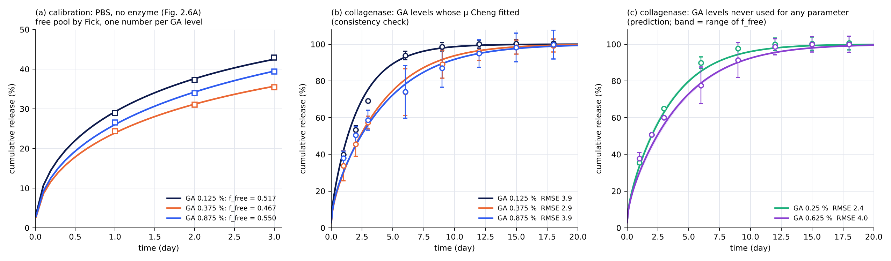
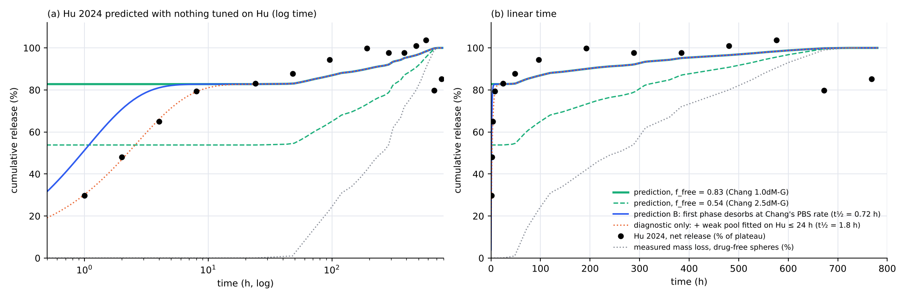
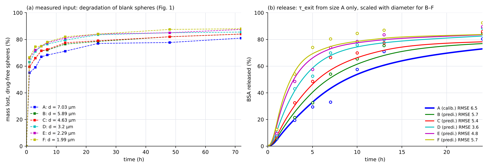
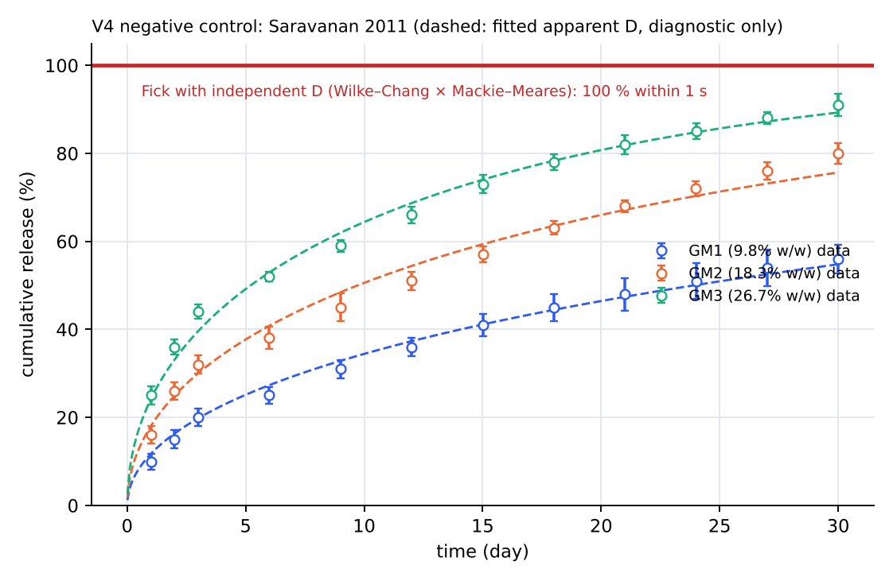
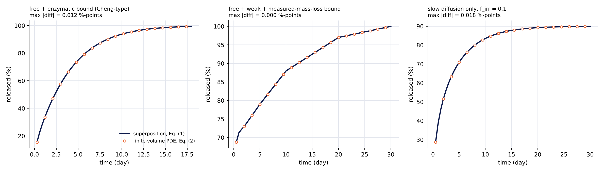
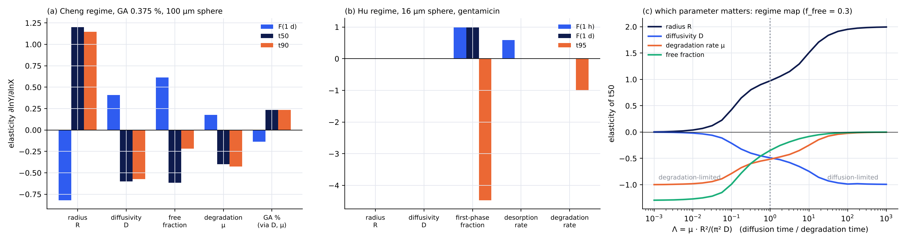
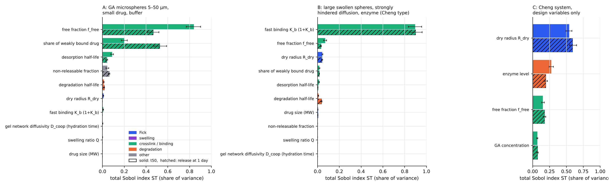
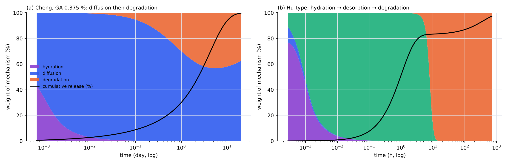

# Gelatin Release Model (GRM) — drug release from glutaraldehyde-crosslinked gelatin spheres

**Version 1.0.0 · 2026-11-11 · Author: Saeedreza Barzkar (MSc thesis project), with AI assistance (Claude)**

A mechanistic, *no-fit-to-the-test-curve* model of drug release from crosslinked gelatin microspheres, verified
against analytical solutions and validated on four published data sets. It is written so that a person or another AI
can continue the work — including a machine-learning layer — without re-deriving anything.

<div dir="rtl">

**خلاصه فارسی.** این مخزن مدل ریاضی رهایش دارو از میکروسفر ژلاتین کراس‌لینک‌شده با گلوتارآلدئید است. دارو در ذره به چند «بخش» تقسیم می‌شود:
آزاد (فوراً متحرک)، متصلِ ضعیف (جداشدن برگشت‌پذیر با ثابت مرتبه اول) و متصل به شبکه (آزادشدن با تخریب شبکه).
داروی متحرک با قانون فیک از کره خارج می‌شود. حل عددی با حل تحلیلی Crank صحت‌سنجی شده (خطا کمتر از ۰٫۰۲ واحد درصد) و مدل روی
داده چهار مقاله آزموده شده است. نتیجه اصلی: پیش‌بینی غلظت‌های GA که در هیچ پارامتری به کار نرفته‌اند با خطای ۲٫۴ و ۴٫۰ واحد درصد (Cheng)،
پیش‌بینی اثر اندازه ذره با خطای ۳٫۶ تا ۵٫۷ (Mladenovska)، و انتقال پارامتر از یک مقاله به مقاله دیگر با خطای ۹٫۴ پس از روز اول (Chang→Hu، قبول ناقص).
قانون فیک به‌تنهایی با ضریب نفوذ مستقل شکست می‌خورد (Saravanan، اختلاف بیش از شش مرتبه بزرگی). کدام پارامتر طراحی مهم است به عدد
Λ = μ·R²/(π²D) بستگی دارد. برای توسعه با یادگیری ماشین، ML باید پارامترهای فیزیکی مدل را از مشخصات فرمولاسیون پیش‌بینی کند، نه خود منحنی را.

</div>

---

## Contents
1. [Quick start](#1-quick-start)
2. [The model](#2-the-model)
3. [Where glutaraldehyde enters](#3-where-glutaraldehyde-enters)
4. [Parameter provenance rules](#4-parameter-provenance-rules)
5. [Verification and validation results](#5-verification-and-validation-results)
6. [Parameter weights and the regime number Λ](#6-parameter-weights-and-the-regime-number-λ)
7. [Data](#7-data)
8. [Repository map](#8-repository-map)
9. [Extending with machine learning](#9-extending-with-machine-learning)
10. [Known limitations and next steps](#10-known-limitations-and-next-steps)
11. [Rules for whoever continues (human or AI)](#11-rules-for-whoever-continues-human-or-ai)
12. [References](#12-references)

---

## 1. Quick start

```bash
pip install -r requirements.txt            # numpy, scipy, pandas, matplotlib, pytest (pdfplumber only for tools/)
python validation/run_all.py               # ~30 s: re-runs every test, writes results/*.json, results/VALIDATION.md, figures/*.png
python -m pytest -q                        # 11 tests: mathematics + pinned validation numbers
python ml/build_training_table.py          # writes ml/formulations.csv and ml/curves_long.csv
python simulator/build_simulator.py        # rebuilds simulator/grm_simulator.html from data/ and results/
```

**Interactive simulator:** open `simulator/grm_simulator.html` in any browser (one self-contained file, no internet needed).
Same equations as `grm/model.py`; presets reproduce the validation cases (Cheng RMSE 2.4/2.9/4.0, Hu 12.4, Mladenovska A 6.5) with the data points;
weights of ALL parameters (Fick, swelling, crosslink/binding, degradation, other) as local elasticities on any output, the time-resolved weight of each mechanism, and the global Sobol weights of §6.1 update live, together with the regime number Λ; curves can be pinned for comparison and exported as CSV/PNG; settings save to JSON.

Minimal use:

```python
import numpy as np
from grm import Particle, Pool, Liberation, release, D_cheng, mu_cheng, DAY

ga = 0.375                                              # % v/v glutaraldehyde
p = Particle(pools=[Pool(0.47, name="free"),            # mobile from t = 0
                    Pool(0.53, Liberation("first_order", rate=mu_cheng(ga)), "bound")],   # freed by enzymatic degradation
             R_cm=50e-4, D_cm2s=D_cheng(ga))            # Fick exit from a 100 µm sphere
t = np.array([1, 3, 6, 12]) * DAY
print(100 * release(t, p))                              # cumulative release, %
```

Python ≥ 3.10. Tested with Python 3.13, NumPy 2.5, SciPy 1.18, pandas 2.x, Matplotlib 3.11.

---

## 2. The model

### 2.1 Pools and liberation laws
The drug in one particle is split into pools. Pool *i* holds mass fraction *fᵢ* and has a **liberation law** *Lᵢ(s)*:
the fraction of that pool that has become mobile by time *s* (0 → 1).

| Pool | Symbol | Liberation law *L(s)* | Physical meaning |
|---|---|---|---|
| free | *f_free* | 1 for *s* ≥ 0 | dissolved / unbound drug, mobile from the start |
| weak | *f_weak* | 1 − exp(−*k_weak* *s*) | reversible (ionic, hydrogen-bond) binding; first-order desorption |
| bound | *f_bound* | 1 − exp(−μ *s*) **or** (1 − *g*(*s*)) / (1 − *g*(∞)) | polyion complex / entrapment, freed only when the network is degraded; μ = first-order enzymatic rate; *g* = **measured** mass fraction remaining |
| irreversible | *f_irr* | 0 | not released within the experiment (plateau < 100 %) |

*f_free + f_weak + f_bound + f_irr = 1* (checked by `Particle.check()`).

### 2.2 Exit kernel
Mobile drug leaves the particle through an exit kernel *K(t)*:

* **Fick (default)** — sphere of radius *R*, uniform load, perfect sink (Crank 1975, Eq. 6.20):

  *K(t) = Φ(Dt/R²)*,  Φ(τ) = 1 − (6/π²) Σₙ exp(−n²π²τ)/n²

* **first-order** — *K(t) = 1 − exp(−t/τ_exit)*; used when a large protein leaves through an eroding front rather than by diffusion (V3).

### 2.3 Release
<pre>
F(t) = Σᵢ fᵢ ∫₀ᵗ K(t − s) dLᵢ(s)                                                     (1)
</pre>

With the Fick kernel, Eq. (1) is the **exact** solution of the linear PDE

<pre>
∂C/∂t = (1/r²) ∂/∂r (D r² ∂C/∂r) + C₀ Σᵢ fᵢ dLᵢ/dt,   ∂C/∂r(0,t) = 0,  C(R,t) = 0,  C(r,0) = f_free C₀     (2)
</pre>

because the source is spatially uniform (Duhamel superposition). This identity is checked numerically in V0 (difference ≤ 0.018 %-points).

### 2.4 Assumptions (all explicit)
1. Spherical particles, one radius per formulation (mean reported in the paper). Size distribution is not yet integrated (see §10).
2. Perfect sink at the surface; no external boundary layer.
3. Freshly liberated drug is uniformly distributed in the sphere (needed for the superposition to be exact).
4. *D* constant in time (swelling is assumed complete before release starts; for GA spheres hydration takes seconds–minutes).
5. Pools do not exchange except through their liberation law (weak drug does not re-bind).

### 2.5 Numerics
* Φ: eigen-series with a rigorous tail bound (tolerance 1e-13) for τ ≥ 0.01, short-time image series below (`grm/fick.py`).
* Eq. (1): Stieltjes sum on 1600 cosine-clustered nodes per output time (`grm/model.py::_pool_release`).
* Reference PDE solver: cell-centred finite volumes on spherical shells (exact shell volumes/areas), surface-graded mesh
  *x_f = 1 − (1 − i/N)²*, Crank–Nicolson with Rannacher start-up (`grm/fick.py::SphereFVM`) and backward Euler with source (`grm/model.py::release_pde`).
* Mesh-independence (thesis Chapter 3): graded *N* = 80 changes every monitored quantity by < 0.1 % when *N* is doubled; observed order 2.0; GCI ≤ 0.13 %.

---

## 3. Where glutaraldehyde enters

GA crosslinks the ε-amino groups of lysine/hydroxylysine (Schiff base → stabilised adducts). In the model it acts through four routes:

| Route | Effect of more GA | Model parameter | Quantitative relation available | Source |
|---|---|---|---|---|
| network density | slightly slower diffusion | *D* | *D* = 7.5132·[GA]^−0.2281 ×10⁻⁴ µm²/s (0.125–0.875 % v/v) — only **1.5×** over a 7× GA range | Cheng 2010, Fig. 2.6B |
| enzymatic degradation | slower, saturating | μ | μ = 0.36 (1 + **10** e^(−14.29·GA)) d⁻¹ | Cheng 2010, Eq. 2.12 (printed coefficient 0.1 is a typo; 10 reproduces the stated μ = 1, 0.38, 0.36) |
| charge / amine consumption | fewer binding sites for anionic drugs, more negative ζ (+4 → −7 mV) | *f_free*, *f_weak* | none yet (measured per formulation) | Cheng 2010, Fig. 2.4 |
| crosslink degree vs mass loss | slower hydrolytic mass loss | *g(t)* | measured curves only (Chang 2023, Hu 2024, Mladenovska 2002) | — |

Main consequence (V4 and the regime map): for small drugs in 10–50 µm GA spheres, diffusion is **never** the slow step
(τ_D ≈ 0.02–0.2 s with an independent *D*); the release time is set by binding/desorption and degradation. Diffusion matters
only for large swollen spheres with strongly hindered diffusion (Cheng: τ_D ≈ 3 days).

---

## 4. Parameter provenance rules

The central rule of this project: **no parameter is fitted to the curve it is tested on.** Every parameter is one of

| Label | Meaning | Allowed in a validation? |
|---|---|---|
| `MEASURED` | reported in the same paper (R, mass loss *g(t)*, loading) | yes |
| `PUBLISHED_RELATION` | a correlation from the literature (Wilke–Chang, Mackie–Meares, Cheng's D(GA), μ(GA)) | yes |
| `CALIBRATED_SEPARATE` | fitted on a *different experiment* than the test (e.g. *f_free* from the no-enzyme curve, τ_exit from one size) | yes, and it must be stated |
| `TRANSFERRED` | taken from a different paper (Chang → Hu) | yes |
| `DIAGNOSTIC_FIT` | fitted on the test curve itself | **never counts as validation**; reported only to size a missing mechanism |

Each validation script states its information flow in its docstring.

---

## 5. Verification and validation results

Generated by `python validation/run_all.py` (the table below is copied from `results/VALIDATION.md`).

| ID | Case | Type of test | Inputs (none fitted to the test curve) | Result | Verdict |
|---|---|---|---|---|---|
| V0 | code verification | FVM vs Crank series; Eq. (1) vs PDE | none (mathematics) | FVM error 0.011 %-pts at N = 80 (2nd order); Eq. (1) vs PDE ≤ 0.018 %-pts | PASS |
| V1 | Cheng 2010, GA 0.25 % & 0.625 % | GA level never used for any parameter | *f_free* from PBS curves; D(GA), μ(GA) published | RMSE 2.44 and 3.98 %-pts; 8 of 11 points inside error bars | **PASS (prediction)** |
| V1b | Cheng 2010, GA 0.125/0.375/0.875 % | same curves Cheng used for μ(GA) | as above | RMSE 3.92 / 2.94 / 3.86 %-pts | PASS (consistency only) |
| V2 | Hu 2024 from Chang 2023 | different paper, same chemistry, no tuning on Hu | *f_free* and desorption rate from Chang; Hu's own mass loss | RMSE after day 1: 9.4; first 8 h: 33.0 (free pool instant) → 17.7 (Chang desorption rate) | **PARTIAL** |
| V3 | Mladenovska 2002, six sizes | sizes B–F predicted from size A | measured mass loss; τ_exit from size A, ∝ diameter | RMSE 3.6–5.7 %-pts (release = mass loss without exit step: 22–31) | **PASS (prediction)** |
| V4 | Saravanan 2011 (negative control) | Fick with independent D | Wilke–Chang × Mackie–Meares | t50 predicted < 0.1 s vs observed 5.2–23.0 d (ratio ≥ 6.2e+06) | FAILS AS EXPECTED |

### V1 — Cheng 2010 (primary validation)

GA-crosslinked basic gelatin (IEP 9), monodisperse 100 µm swollen spheres, trypan blue (acidic dye), PBS ± collagenase 373 ng/ml.
Data were **vector-extracted** from the dissertation PDF (`tools/digitize_cheng2010.py`; marker centres from the drawing commands, axes from tick marks).
*f_free* (0.517 / 0.467 / 0.550) is calibrated on the 3-day no-enzyme curves only; the five enzyme curves are then predicted.
GA 0.25 % and 0.625 % were not used by Cheng or by us for any parameter. *f_free* at those levels is interpolated; the shaded band shows the full range of *f_free*.

### V2 — cross-paper transfer, Chang 2023 → Hu 2024 (partial pass)

From day 1 onward the prediction is good (RMSE 9.4 %-pts, 24 h level 83 vs 84 %). The first 8 h are not: with an instantaneous free pool RMSE = 33;
with the desorption rate measured in Chang's PBS data (t½ = 0.72 h, **transferred**, not fitted) RMSE = 17.7; a diagnostic fit on Hu gives t½ = 1.8 h.
Hu released into **deionised water**, Chang into **PBS**: ionic desorption of cationic gentamicin from anionic type-B gelatin is expected to be slower without
counter-ions. This is the main open mechanism (§10). The last two Hu points (days 28–32) are a background-subtraction artefact (drug-free background rises).

### V3 — size effect in an enzymatic medium (Mladenovska 2002)

BSA (66 kDa) is treated as fully network-bound (*f_free* = 0). Liberation follows the measured mass loss of drug-free spheres of the same series.
A Fick exit with any plausible BSA diffusivity empties a 3.5 µm sphere in seconds, so exit is first order with τ_exit calibrated on the largest size and
scaled ∝ diameter (constant front speed 0.62 µm/h). The free per-size fit gives τ ∝ d^0.90, consistent with the hypothesis.

### V4 — negative control (Saravanan 2011)

Fick with an independent *D* (Wilke–Chang 7.4×10⁻⁶ cm²/s × Mackie–Meares) predicts 50 % release in 0.02–0.07 s; observed t50 is 5.2–23 days.
An apparent *D* fitted to the data (diagnostic) is 5×10⁻¹⁴–3.5×10⁻¹³ cm²/s, i.e. 10⁷–10⁸ below the physical value: the "Fickian" label in the original paper
(Higuchi best, n ≈ 0.4–0.5) describes curve shape, not mechanism. The full model cannot be tested on this paper because no mass-loss or binding data were reported.

### V0 — verification


---

## 6. Parameter weights and the regime number Λ



Elasticities *E = ∂ln(output)/∂ln(parameter)* (central difference ±10 %), `validation/w1_parameter_weights.py`:

| Cheng, GA 0.375 % | radius R | diffusivity D | free fraction | degradation μ | GA % (via D and μ) |
|---|---|---|---|---|---|
| F(1 day) | −0.82 | +0.41 | +0.61 | +0.18 | −0.14 |
| t50 | **+1.20** | −0.60 | −0.62 | −0.40 | +0.23 |
| t90 | +1.15 | −0.57 | −0.22 | −0.43 | +0.24 |

In the Hu regime (16 µm, gentamicin) *R* and *D* have **zero** weight; the release is controlled by the first-phase fraction (F(1 d) elasticity 1.0),
the desorption rate (F(1 h) 0.59) and the degradation time scale (t95 −1.0).

**General result (panel c).** Which design parameter matters is set by one dimensionless number

<pre>
Λ = μ · R²/(π² D)  =  diffusion time / liberation time
</pre>

* Λ ≪ 0.1 (small spheres, small drugs — most GA microspheres): t50 depends on μ (elasticity −1) and the free fraction; *R* and *D* do nothing.
* Λ ≫ 10 (large, strongly hindered spheres): t50 ∝ R²/D (elasticities +2 and −1); degradation does nothing.
* Cheng sits at Λ ≈ 1.2 (mixed): everything matters. Hu sits at Λ ≈ 10⁻⁸.

This is the key design rule and the most important feature for any data-driven extension (§9).

### 6.1 All parameters: Fick → swelling → crosslinking / binding → degradation → other

`validation/w2_all_parameters.py`, model `grm/fast.py` (closed form of Eq. (1) with a hydration gate; verified against the PDE in `tests/test_fast.py`).
Every *primitive* parameter a formulator can change is mapped into the model:

| Stage | Primitive parameter | How it enters |
|---|---|---|
| Fick | dry radius *R_dry*; drug size (MW) | *R = R_dry Q^(1/3)*; *D_w* by Stokes–Einstein from MW |
| swelling | volume swelling ratio *Q*; collective gel diffusivity *D_coop* | polymer fraction 1/*Q* in Mackie–Meares; hydration time *τ_sw = R²/(π² D_coop)* (Tanaka & Fillmore 1979) gates every pool |
| crosslink / binding | fast reversible binding *K_b*; free fraction; share of weakly bound drug; desorption half-life; (GA % through Cheng's relations) | *D_eff = D_w MM(1/Q)/(1+K_b)*; pool sizes; first-order desorption |
| degradation | degradation half-life (or enzyme level, or the measured mass-loss curve) | first-order liberation of network-bound drug |
| other | non-releasable fraction | plateau below 100 % |

**(1) Global weights** — total Sobol index *S_T* (share of output variance incl. interactions; Saltelli/Jansen estimators, 1024 scrambled-Sobol base samples, 200 bootstrap resamples) over two design regimes:
regime **A** = GA microspheres 5–50 µm, small drug, buffer (Saravanan/Chang/Hu/Liu type); regime **B** = large swollen spheres with strongly hindered diffusion and enzyme (Cheng type). Ranges are in the script and in `results/w2_all_parameters.json`.

| Stage | Parameter | A: t50 | A: release 1 d | A: t90 | B: t50 | B: release 1 d |
|---|---|---|---|---|---|---|
| Fick | dry radius R_dry | 0.01 | 0.00 | 0.00 | 0.04 | 0.04 |
| Fick | drug size MW | 0.00 | 0.00 | 0.00 | 0.00 | 0.00 |
| swelling | swelling ratio Q | 0.00 | 0.00 | 0.00 | 0.00 | 0.00 |
| swelling | gel network diffusivity D_coop (hydration time) | 0.00 | 0.00 | 0.00 | 0.00 | 0.00 |
| crosslink / binding | fast reversible binding 1+K_b | 0.01 | 0.00 | 0.00 | **0.90** | **0.90** |
| crosslink / binding | free fraction | **0.84** | **0.47** | **0.13** | 0.07 | 0.03 |
| crosslink / binding | share of weakly bound drug | **0.20** | **0.53** | **0.26** | 0.02 | 0.02 |
| crosslink / binding | desorption half-life | 0.09 | 0.04 | 0.04 | 0.01 | 0.00 |
| degradation | degradation half-life | 0.01 | 0.02 | 0.07 | 0.01 | 0.04 |
| other | non-releasable fraction | 0.04 | 0.06 | **0.85** | 0.00 | 0.00 |

In regime A the release at 7 days is shared by weakly bound share 0.44, free fraction 0.32, degradation half-life 0.30 and non-releasable fraction 0.12 (t90 is dominated by the non-releasable fraction because 90 % is often never reached).



Regime **C** = Cheng's own design variables (GA 0.125–0.875 %, swollen radius 25–75 µm, enzyme ×0.25–4, free fraction 0.3–0.7):

| Cheng design variable | t50 | release 7 d |
|---|---|---|
| R_dry | 0.54 | 0.41 |
| enzyme | 0.27 | 0.50 |
| f_free | 0.15 | 0.06 |
| GA | 0.07 | 0.08 |

**(2) Local elasticities** at the validated Cheng point (Q = 6 and D_coop = 10⁻⁷ cm²/s assumed; K_b set so that D_eff equals Cheng's fitted D, i.e. 1+K_b ≈ 1.6×10⁵):

| Parameter (Cheng, GA 0.375 %) | t50 | release 1 h | release 1 d |
|---|---|---|---|
| dry radius R_dry | +1.20 | -0.97 | -0.82 |
| drug size MW | +0.20 | -0.16 | -0.14 |
| swelling ratio Q | -0.01 | +0.01 | +0.01 |
| gel network diffusivity D_coop (hydration time) | -0.00 | +0.00 | +0.00 |
| fast reversible binding 1+K_b | +0.60 | -0.48 | -0.41 |
| free fraction | -0.62 | +0.98 | +0.61 |
| degradation half-life | +0.40 | -0.01 | -0.18 |

**(3) Which mechanism controls at each moment** (degree of rate control on the four rates):



**Answer to "which parameters control release, and how much".**
1. **Swelling (Q, hydration time) has ~zero weight in every regime.** Hydration takes seconds to a minute (τ_sw ≈ 0.3–25 s for swollen diameters of 10–100 µm with D_coop ≈ 10⁻⁷ cm²/s, an assumed typical value), and the swelling ratio cancels in the diffusion time: t_D ∝ R²/D ∝ Q^(2/3)/MM(1/Q), whose elasticity 2/3 − 4Q/(Q²−1) is zero at Q = 3+√10 ≈ 6.2 and small for 3 < Q < 15. Swelling matters only for tightly crosslinked gels (Q < 2.5) in the diffusion-limited regime.
2. **Fick parameters (radius, drug size) matter only when diffusion is the slow step (Λ ≳ 0.1).** In regime A their weight is ≈ 0; in Cheng's system the radius is the largest single weight (S_T 0.54 for t50).
3. **Crosslinking acts through binding, not through mesh size.** In regime A the free fraction (S_T 0.84 for t50) and the weakly bound share decide the burst and t50; in regime B the fast binding constant K_b (S_T 0.90) decides everything, because it is what slows diffusion by five orders of magnitude. GA concentration itself, through Cheng's relations, carries only S_T 0.07 — its effect saturates above ~0.375 %.
4. **Degradation controls the tail** (release after a week, t90): S_T 0.30 for release at 7 days in regime A, 0.50 for Cheng; and in enzyme media it is the second lever after size.

---

## 7. Data

All files in `data/`. Every number has a source (figure/page) and an evidence label. No PDF is included (copyright).

| File | Content | Evidence |
|---|---|---|
| `cheng2010_release_vector.csv` | Cheng 2010 Figs 2.6A, 2.7, 2.8: 57 markers with error-bar half-heights | `VECTOR_EXTRACTED` (marker centres from PDF drawing commands; triangle centroid corrected) |
| `saravanan2011_fig6_vector.csv` | Saravanan 2011 Fig. 6, three loadings, SE bars | `VECTOR_EXTRACTED` |
| `release_dataset_audited.csv` | audited points of 8 papers (Jin 2023, Saravanan 2011, Kodra 2026, Zhang 2023, Chang 2023, Hu 2024, Lan 2017, Liu 2022) with include/exclude flags and reasons | `DIRECT_FIGURE_DATA_LABEL`, `VECTOR_EXTRACTED`, `DIGITIZED_AUTO`, `DIGITIZED_VISUAL` |
| `mladenovska2002_digitized.csv` | release and blank-sphere mass remaining, six sizes | `DIGITIZED_RASTER` (400 dpi, ±1–2 %) |
| `hu2024_mass_remaining.csv` | mass remaining of drug-free m-Em in water (Fig. 3) | `DIGITIZED_RASTER` (±2 %) |
| `chang2023_mass_loss_regressions.csv` | linear weight-loss regressions printed in Chang 2023 Sec. 3.4 | `DIRECT_PROSE` |

**Adding a paper (checklist).**
1. Extract the release curve with the best available method (printed numbers > vector extraction > raster digitization); record figure, page, evidence label, uncertainty.
2. Record every formulation descriptor in `ml/build_training_table.py` (leave unknowns empty — never guess).
3. Record the independent measurements the model can use: radius (and its basis: dry/swollen), mass loss *g(t)*, swelling, binding/EE, release in a non-degrading medium.
4. Write `validation/vN_<paper>.py` with a docstring stating the information flow (§4) and add it to `run_all.py`.
5. If the paper lacks the inputs the model needs, report it as *not testable* (like V4) — do not fit.

---

## 8. Repository map

```
grm/                       the model (import grm)
  fick.py                  Crank series with tail bound, short-time series, profiles, spherical FVM (CN + Rannacher)
  model.py                 pools, liberation laws, exit kernels, release() = Eq. (1), release_pde() = Eq. (2)
  correlations.py          Wilke–Chang, Le Bas volumes, Mackie–Meares, Stokes–Einstein, Cheng D(GA) and μ(GA), drug table
  analysis.py              RMSE, R², t_x, elasticities, degree of rate control
  fast.py                  closed-form Eq. (1) with hydration gate and primitive parameters (R_dry, MW, Q, D_coop, K_b, ...) — vectorised
validation/                one script per test; run_all.py regenerates results/ and figures/
data/                      extracted data with provenance (see §7)
results/                   JSON outputs + VALIDATION.md (auto-generated)
figures/                   PNG figures (auto-generated)
ml/                        build_training_table.py -> formulations.csv, curves_long.csv
simulator/                 template.html + build_simulator.py -> grm_simulator.html (offline, single file)
tools/digitize_cheng2010.py  vector extraction from the dissertation PDF (needs pdfplumber and the PDF)
tests/test_model.py        pytest: mathematics + pinned validation numbers
AGENTS.md                  short operating rules for an AI agent continuing this repository
CHANGELOG.md
```

The older exploratory work (Abdekhodaie ion-exchange model, Kodra degradation DOE, design maps, decks, Word reports) lives in the sibling folders of
`modeling/` on this branch and on `backup/modeling-2026-11-08`. GRM is the consolidated, tested version.

---

## 9. Extending with machine learning

### 9.1 Architecture: ML predicts parameters, physics predicts curves
```
formulation descriptors X  ──ML──►  physical parameters θ = (f_free, f_weak, k_weak, μ or g(t) time scale, D, τ_exit, f_irr)
                                        │
                                        ▼
                               grm.release(t, θ, R)  ──►  release curve F(t)
```
Why not learn curves directly: the audited gelatin data hold only a few dozen formulations with usable curves (21 in `data/release_dataset_audited.csv`, 14 more in the Cheng and Mladenovska files); a curve-to-curve
model would interpolate shapes without physics and could not extrapolate in size, time or medium. θ has 5–7 numbers with physical bounds,
and the validated model guarantees mass balance, monotonicity and correct size scaling (Λ).

### 9.2 Inputs (X) — already laid out in `ml/formulations.csv`
crosslinker type · crosslinker concentration and unit · crosslink time and temperature · crosslink mode (in-situ / post) · degree of crosslinking (TNBS/ninhydrin) ·
gelatin type (A/B), IEP, Bloom, concentration · fabrication method · radius and its basis (dry/swollen) · drug MW, net charge at release pH, log P, pKa ·
loading method (incorporated / soaked) and loading % · release medium (buffer / water / enzyme and concentration / ionic strength) · temperature.
Derived features that carry physics: **Λ**, charge product (drug charge × gelatin net charge at pH 7.4), Le Bas volume, free-solution *D_w*.

### 9.3 Targets (Y) and how to obtain them per paper
| Target | Best independent measurement | Fallback |
|---|---|---|
| *f_free* | release in a non-degrading medium (plateau), or wash-out | first release plateau |
| *f_weak*, *k_weak* | release vs ionic strength; early time points (< 2 h) | — (missing in most papers) |
| μ or *g(t)* | mass loss of drug-free particles in the same medium | degree of crosslinking → μ relation (to be built) |
| *D* | measured diffusivity; else Wilke–Chang × Mackie–Meares | — |
| *f_irr* | final plateau below 100 % | — |

### 9.4 Rules for the ML layer
1. **Split by paper** (`split_group` column), never by point or by formulation: points of one paper share lab, assay and normalisation.
2. Report error on held-out papers in %-points of release *after* passing θ̂ through `grm.release`, not only error on θ.
3. Keep the provenance label of every target; train first on `MEASURED`/`PUBLISHED_RELATION` targets.
4. Use bounded outputs (sigmoid for fractions, log for rates) and propagate uncertainty (ensembles or Gaussian processes; the data set is small).
5. Use Λ to stratify: a model trained only on Λ ≪ 1 data must not be used for Λ ≫ 1 formulations.
6. Recommended first model: Gaussian-process or gradient-boosted regression of log μ and logit *f_free* on (crosslinker, concentration, crosslink degree, gelatin type, drug charge product, medium). Then active learning: the experiment with the largest predictive variance on t50 is the next one to run.

### 9.5 Data the ML layer needs most (in order)
1. mass loss of drug-free spheres for every formulation (gives μ or *g(t)* directly);
2. release in buffer **and** in enzyme for the same spheres (separates *f_free* from the degradation pool, as Cheng did);
3. early sampling (5 min – 2 h) at two ionic strengths (gives *k_weak*);
4. swollen radius distribution, not only dry mean.

---

## 10. Known limitations and next steps

| # | Limitation | Consequence | Next step |
|---|---|---|---|
| 1 | *D*(GA) and μ(GA) relations exist only for Cheng's system (basic gelatin, acidic dye, collagenase 373 ng/ml) | cannot be transferred to other gelatins/drugs/enzyme levels as is | build μ(crosslink degree, enzyme) from more papers; Cheng notes μ ∝ [enzyme] (or ²) |
| 2 | no predictive relation for *f_free* from gelatin type, GA/gelatin ratio and loading | *f_free* must be measured | collect buffer-only release data; model charge balance (Abdekhodaie & Wu 2006 ion-exchange framework is in `../02_abdekhodaie2006`) |
| 3 | desorption rate depends on the medium (PBS vs water) | V2 early-hour error | add an ionic-strength-dependent *k_weak* (ion-exchange kinetics) and test on a paper with two media |
| 4 | single radius per formulation | broad size distributions (Saravanan 1–60 µm) are smeared | integrate F over the number/volume size distribution (straightforward, Eq. (1) is linear) |
| 5 | Cheng's *f_free* at 0.25/0.625 % is interpolated | small extra uncertainty in V1 | shown as a band in Fig. V1 |
| 6 | Mladenovska and Hu inputs are raster-digitized (±1–2 %) | small | redo with vector extraction if the PDFs are vector |
| 7 | swelling kinetics not in the model (assumed instantaneous) | could matter for dry-loaded large spheres in the first minutes | the swelling/hydration solver exists in `../04_gelatin_routes` |

---

## 11. Rules for whoever continues (human or AI)

See `AGENTS.md`. In short:
* Never fit *D* (or any parameter) to the curve that is used to judge the model. Fits are allowed only as labelled diagnostics.
* Every new number gets a source (paper, figure, page) and an evidence label.
* After any change: `python validation/run_all.py && python -m pytest -q`; if a validation number moves, update this README and `CHANGELOG.md`.
* Report failures as failures (V2 is "partial", V4 "fails as expected"). A model that passes everything is not credible with these data.
* Work on a branch; do not push to `main` of this repository (it is a separate web-app project).

---

## 12. References
1. Crank J. *The Mathematics of Diffusion*, 2nd ed. Oxford University Press, 1975.
2. Cheng F. *Study of drug delivery and cell encapsulation using biocompatible hydrogel.* PhD dissertation, University of Illinois at Urbana-Champaign, 2010, Ch. 2. (Published as Cheng F. et al., Int. J. Pharm. 403 (2011) 90–95.)
3. Chang K.-C. et al. Polymers 15 (2023) 1504. doi:10.3390/polym15061504
4. Hu M.-H. et al. Materials 17 (2024) 3578. doi:10.3390/ma17143578
5. Mladenovska K. et al. Biodegradation and drug release studies of BSA loaded gelatin microspheres. Int. J. Pharm. 242 (2002) 247.
6. Saravanan M. et al. J. Drug Target. 19 (2011) 96–103. doi:10.3109/10611861003733979
7. Wilke C.R., Chang P. AIChE J. 1 (1955) 264–270.
8. Mackie J.S., Meares P. Proc. R. Soc. Lond. A 232 (1955) 498–509.
9. Poling B.E., Prausnitz J.M., O'Connell J.P. *The Properties of Gases and Liquids*, 5th ed. McGraw-Hill, 2001 (Le Bas volumes).
10. Campbell C.T. J. Catal. 204 (2001) 520–524 (degree of rate control).
11. Celik I.B. et al. J. Fluids Eng. 130 (2008) 078001 (grid convergence index).
12. Rannacher R. Numer. Math. 43 (1984) 309–327.
13. Abdekhodaie M.J., Wu X.Y. Biomaterials 27 (2006) 3652–3662.
14. Siepmann J., Peppas N.A. Int. J. Pharm. 418 (2011) 6–12 (Higuchi: derivation, use and misuse).
